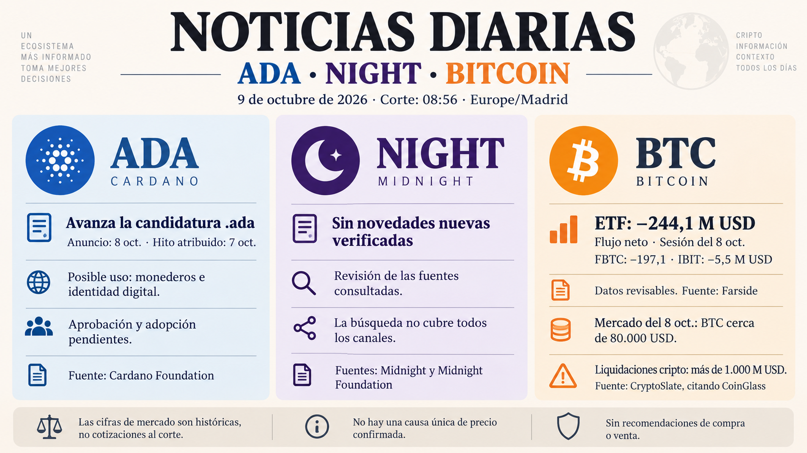

**Informe diario de ADA, NIGHT y Bitcoin — 9 de octubre de 2026**

Corte documental: **08:56, Europe/Madrid**. Novedades no recogidas en el informe anterior; las fechas del hecho y de publicación se indican por separado.

**ADA — Avanza la candidatura del dominio «.ada»**

Cardano Foundation anunció el **8 de octubre** que su solicitud de «.ada» pasa a la siguiente fase del programa de dominios de ICANN. Según la Fundación, el hito se confirmó el **7 de octubre**, al publicarse la lista de solicitudes que avanzan. **Todavía quedan evaluaciones y la aprobación final**. La Fundación sitúa las posibles delegaciones entre 2028 y 2030, dependiendo del proceso. [Comunicado oficial, publicado el 8 de octubre](https://cardanofoundation.org/blog/ada-icann-next-stage).

Su posible impacto es facilitar direcciones de monederos, identidad digital y tokenización de dominios. Son usos previstos: faltan aprobación y adopción efectiva, y no hay evidencia que vincule este anuncio con un movimiento concreto del precio de ADA.

**NIGHT — Sin novedades relevantes nuevas verificadas**

No he localizado noticias fundamentales nuevas posteriores al informe de ayer en las fuentes consultadas. La revisión del [blog oficial de Midnight](https://midnight.network/blog) y de la [Fundación](https://midnight.foundation/) no permite añadir un anuncio nuevo confirmado. Esta conclusión se limita a la búsqueda realizada; no acredita ausencia de novedades en todos los canales. No hay un hecho nuevo verificado al que atribuir un impacto sobre NIGHT.

**Bitcoin — Caída descrita ayer y segunda sesión de salidas de ETF**

CryptoSlate informó el **8 de octubre** de un mínimo intradía de BTC cercano a **80.000 USD** y de más de **1.000 millones de USD en liquidaciones en el conjunto del mercado cripto**, citando CoinGlass para las 24 horas anteriores. Son cifras históricas del artículo, **no una cotización al corte de hoy**. La publicación mezcla cifras de distintas lecturas; no he reconstruido esa ventana directamente en CoinGlass. [Artículo de CryptoSlate, publicado el 8 de octubre](https://cryptoslate.com/bitcoin-crashes-through-81000-buy-wall-as-1-billion-crypto-liquidation-bloodbath-unfolds/).

Para la **sesión estadounidense del 8 de octubre**, Farside muestra **244,1 millones de USD de salidas netas** de ETF de Bitcoin, con datos presentes para los doce fondos:

| Fondo | Flujo neto, millones de USD |
|---|---:|
| FBTC | −197,1 |
| ARKB | −20,3 |
| BITB | −17,7 |
| GBTC | −8,2 |
| IBIT | −5,5 |
| EZBC | +4,7 |
| Otros seis fondos | 0,0 |
| **Total** | **−244,1** |

La suma coincide con el total publicado. Es la segunda sesión consecutiva de salidas; las sesiones del 7 y 8 suman **729,0 millones de USD**, cálculo propio sobre Farside. **Consulta: 9 de octubre; hora exacta de publicación no disponible.** Las cifras son revisables y no se han conciliado individualmente con los emisores. [Tabla de Farside](https://farside.co.uk/btc/).

Las liquidaciones pueden amplificar una caída y las salidas reflejan menor exposición neta mediante esos fondos. Estas observaciones no establecen un detonante único ni prueban ventas simultáneas de BTC al contado.

Informe informativo, sin recomendaciones de compra o venta.
