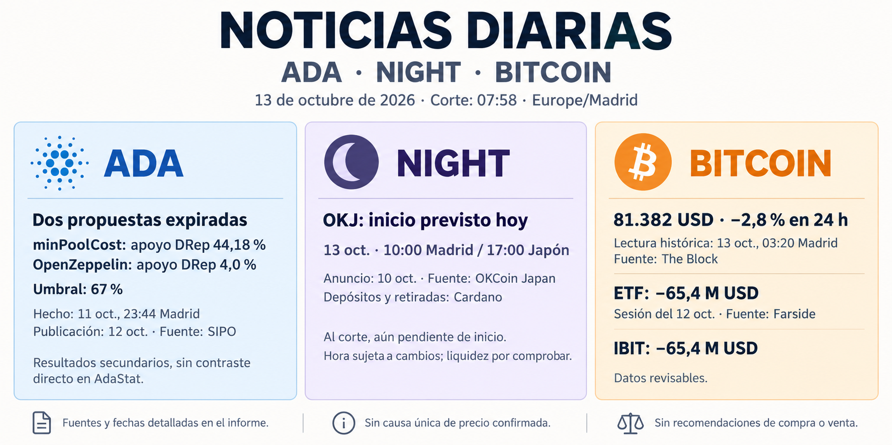

**Informe diario de ADA, NIGHT y Bitcoin — 13 de octubre de 2026**

Corte documental: **07:58, Europe/Madrid**. Las cotizaciones citadas son históricas; no forman una fotografía simultánea al corte.

**ADA — Dos propuestas vencen sin aprobarse**

SIPO publicó el **12 de octubre** que la propuesta para reducir minPoolCost de 170 a 75 ADA y la retirada de **11.787.063 ADA** para el proyecto OpenZeppelin expiraron al comenzar la época 661. Sitúa el vencimiento aproximadamente a las **23:44 del 11 de octubre, hora de Madrid** —ya era el día 12 en Japón—. Atribuye apoyos DRep del **44,18 %** y **4,0 %**, respectivamente, por debajo del umbral del 67 %. [Informe de SIPO](https://sipo.tokyo/epoch-660/).

La reducción y esa financiación no quedaron aprobadas mediante estas propuestas. **Los resultados proceden de una fuente secundaria**: no pude contrastar directamente las fichas de AdaStat. No hay evidencia que permita atribuirles un movimiento concreto de ADA.

**NIGHT — Inicio previsto hoy en OKJ**

OKCoin Japan anunció el **10 de octubre** que incorporará NIGHT a OKJ el **13 de octubre a las 17:00 de Japón, equivalentes a las 10:00 de Madrid**. Incluye negociación, compraventa, compras periódicas y depósitos y retiradas mediante Cardano. La negociación exige el sistema actualizado y el comunicado advierte que la hora puede variar. [Comunicado de la empresa en PR TIMES](https://prtimes.jp/main/html/rd/p/000000193.000054229.html).

Al corte, **el inicio todavía es futuro**. Puede ampliar el acceso al token en Japón, pero faltan confirmación operativa y datos de volumen y liquidez. El anuncio anterior se incluye por su ejecución prevista hoy; no demuestra un efecto sobre el precio.

**Bitcoin — Caída durante la madrugada y nuevas salidas de ETF**

The Block registró BTC en **81.382 USD, con −2,8 % en 24 horas**, a las **03:20 del 13 de octubre en Madrid** —21:20 del día 12 en Nueva York—. El artículo se publicó a las **03:57 de Madrid** y se actualizó a las 04:23. También recoge **771 millones de USD de liquidaciones del mercado cripto**, de los cuales 685,6 millones correspondían a posiciones alcistas, citando CoinGlass. [Noticia de The Block](https://www.theblock.co/news/markets/2026-10-12-bitcoin-slides-crypto-liquidations-surge-418374).

Es una lectura histórica periodística; las liquidaciones abarcan todo el mercado cripto y no se han reconstruido directamente en CoinGlass.

Para la **sesión estadounidense del 12 de octubre**, Farside muestra:

| Concepto | Flujo neto, millones de USD |
|---|---:|
| IBIT | −65,4 |
| Otros once fondos | 0,0 |
| **Total** | **−65,4** |

Las doce columnas contienen datos y su suma coincide con el total. **Consulta: 13 de octubre; hora de publicación de la fila no disponible.** Son cifras revisables y sin conciliación individual con los emisores. [Tabla de Farside](https://farside.co.uk/btc/).

Las liquidaciones pueden amplificar las caídas y los flujos reflejan menor exposición neta mediante esos fondos. No establecen una causa única ni prueban ventas simultáneas de BTC al contado.

Informe informativo, sin recomendaciones de compra o venta.
