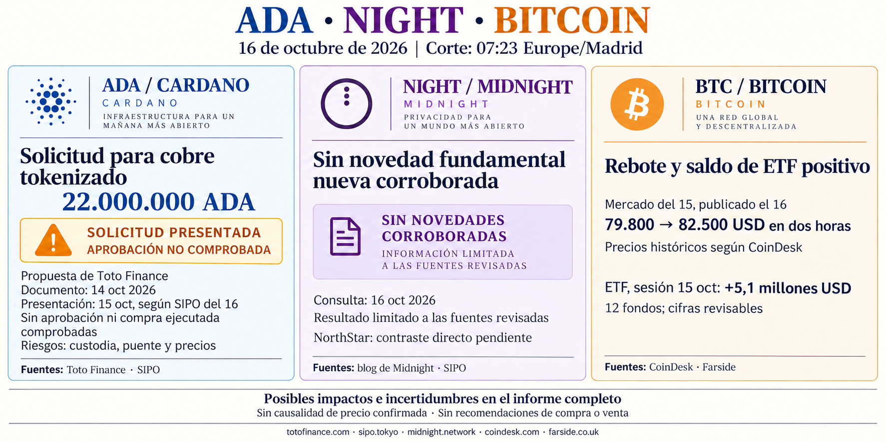

**Informe diario de ADA, NIGHT y Bitcoin — 16 de octubre de 2026**

Corte documental: **07:23, Europe/Madrid**. Se distinguen los hechos, su publicación y las limitaciones de verificación.

**ADA — Propuesta de 22 millones de ADA para cobre tokenizado**

Toto Finance solicita una retirada de **22.000.000 ADA** de la tesorería para adquirir cobre físico y representarlo mediante **CuTT**. El documento primario está **fechado el 14 de octubre**; no se ha establecido su fecha exacta de publicación. La cobertura de **SIPO del 16** sitúa la presentación de la acción de gobernanza el **15 de octubre**. [Propuesta original de Toto Finance](https://totofinance.com/cardano-treasury-proposal-strategic-tokenized-copper-reserve/Cardano_Toto-Finance_Tokenized_Copper_CuTT_Treasury_Proposal.pdf), [fecha de presentación según SIPO](https://sipo.tokyo/signal-20261016-d230af5d/).

**Es una solicitud, no una compra ejecutada ni un gasto aprobado comprobado.** No se pudo contrastar directamente el estado de votación en los exploradores enlazados. El diseño contempla emisión en Ethereum y una representación mediante puente en Cardano.

Si se aprobara y ejecutara, sería un ensayo de tokenización de activos reales financiado por la tesorería. Mantiene riesgos de custodia, puente, precio del cobre, tipo de cambio de ADA y costes. El propio documento **no garantiza recuperar el principal ni obtener beneficios**. No hay un impacto demostrado sobre el precio de ADA.

**NIGHT — Sin novedades fundamentales nuevas corroboradas**

No he corroborado una novedad fundamental nueva desde el informe anterior en las fuentes consultadas. Las nuevas referencias de SIPO a actividad de NorthStar siguen sin contraste directo del anuncio o de datos en cadena; no se presentan como métricas confirmadas de adopción. Esta conclusión es limitada al alcance de la búsqueda. [Blog oficial de Midnight](https://midnight.network/blog), [cobertura de SIPO del 16](https://sipo.tokyo/daily-intel-20261016/).

**Bitcoin — Rebote tras perder 80.000 USD y entradas pequeñas en ETF**

CoinDesk, en una noticia publicada el **16 de octubre a las 00:14 EDT —06:14 de Madrid—**, describe una caída del **jueves 15** hasta unos **79.800 USD** y una recuperación hasta cerca de **82.500 USD en dos horas**, seguida de negociación por encima de 81.000 USD durante la sesión asiática.

Son **precios históricos recogidos por esa publicación**, no cotizaciones simultáneas de hoy al corte. CoinDesk también describe una recuperación de las bolsas asiáticas: la coincidencia aporta contexto, pero **no demuestra que compradores asiáticos causaran el rebote**. [Noticia de CoinDesk](https://www.coindesk.com/markets/2026/10/16/bitcoin-buyers-snap-up-a-brief-drop-below-usd80-000-as-asian-stocks-rebound).

Para la **sesión estadounidense del 15 de octubre**, Farside muestra **5,1 millones de USD de entradas netas**:

| Fondo | Flujo neto, millones de USD |
|---|---:|
| IBIT | +16,8 |
| BTCO | −4,1 |
| BTC de Grayscale | −7,6 |
| Otros nueve fondos | 0,0 |
| **Total** | **+5,1** |

Las doce columnas están presentes y la suma coincide. **Consulta del 16; hora exacta de publicación no disponible.** Son cifras revisables, sin conciliación individual con los emisores. [Tabla original de Farside](https://farside.co.uk/btc/).

El saldo positivo indica una entrada neta pequeña a través de esos fondos en esa sesión. No demuestra una recuperación sostenida de la demanda ni explica por sí solo el rebote; las ventanas del mercado y de los ETF son distintas.

Informe informativo, sin recomendaciones de compra o venta.
