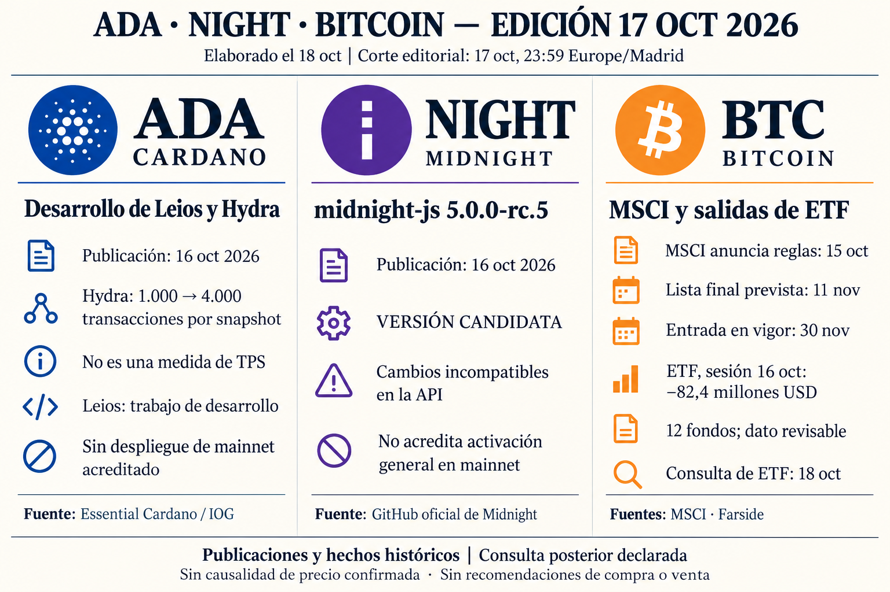

**Informe diario de ADA, NIGHT y Bitcoin — 17 de octubre de 2026**

**Edición pendiente del 17, elaborada el 18 de octubre.** Corte editorial de noticias: **17 de octubre, 23:59, Europe/Madrid**. Las consultas posteriores se identifican; no se presenta esta entrega como realizada a la hora programada.

**ADA — Desarrollo de Leios y ampliación del límite de Hydra**

El informe de desarrollo de IOG publicado el **16 de octubre** comunica la definición de **EndorserBlock** y una consulta del comité de Leios en el ledger. También informa de que Hydra elevó el límite de transacciones por snapshot de **1.000 a 4.000**. Son trabajos de esa semana; no se fecha individualmente cada cambio. [Informe original de desarrollo](https://www.essentialcardano.io/development-update/weekly-development-report-2026-10-16).

Estas mejoras pueden ampliar las herramientas de escalado y verificación. **4.000 transacciones por snapshot no son 4.000 transacciones por segundo** ni capacidad general de Cardano. El anuncio no acredita Leios desplegado en mainnet, adopción efectiva o un efecto sobre el precio de ADA.

**NIGHT — Nueva versión candidata para desarrolladores**

El repositorio oficial publicó el **16 de octubre** la versión **midnight-js 5.0.0-rc.5**, marcada como **pre-release**. Incluye cambios incompatibles en la API, tratamiento de valores según la era del ledger y lectura del estado de contratos. [Publicación original en GitHub](https://github.com/midnightntwrk/midnight-js/releases/tag/v5.0.0-rc.5).

Puede facilitar la adaptación de aplicaciones, pero también exige revisar compatibilidad. **Es una versión candidata del kit de desarrollo**, no prueba de activación de esas funciones en toda mainnet, disponibilidad de staking o aumento de demanda de NIGHT. No se han ejecutado pruebas propias del software.

**Bitcoin — Nuevas reglas de MSCI y salidas en ETF**

MSCI anunció el **15 de octubre a las 20:48 GMT —22:48 de Madrid—** que aplicará criterios para excluir empresas clasificadas como no operativas. Los cambios entrarán en vigor al cierre del **30 de noviembre**, y la lista final se publicará el **11 de noviembre**. Para integrantes actuales, la exclusión exige incumplir el filtro en los dos periodos anuales más recientes. [Anuncio original de MSCI](https://app2.msci.com/webapp/index_ann/DocGet?format=html&lang=en&pub_key=aq0wbkjxPgo%3D).

La cobertura de The Block identifica a Strategy entre las empresas expuestas a esa evaluación. Podría afectar a la demanda de sus acciones por fondos indexados y a su financiación. **No acredita que Strategy ya esté excluida ni que deba vender sus bitcoins**; tampoco confirma un efecto causal sobre BTC. La noticia se incorpora ahora al seguimiento, conservando su fecha real. [Cobertura de The Block](https://www.theblock.co/news/business/2026-10-15-msci-rules-could-exclude-strategy-mstr-from-indexes-418729).

Para la **sesión estadounidense del 16 de octubre**, Farside muestra:

| Fondo | Flujo neto, millones de USD |
|---|---:|
| IBIT | −71,8 |
| FBTC | −10,6 |
| Otros diez fondos | 0,0 |
| **Total** | **−82,4** |

Las doce columnas están presentes y la suma coincide. **Consulta del 18 de octubre; hora de publicación desconocida.** No se reconstruye qué versión estaba disponible al cierre del 17. Son cifras revisables, sin conciliación con cada emisor. [Tabla de Farside](https://farside.co.uk/btc/).

Las salidas reflejan una reducción neta de exposición mediante esos fondos en esa sesión; no equivalen a ventas simultáneas de BTC ni demuestran una tendencia persistente.

No se incluyen precios actuales de los tres activos. Informe informativo, sin recomendaciones de compra o venta.
