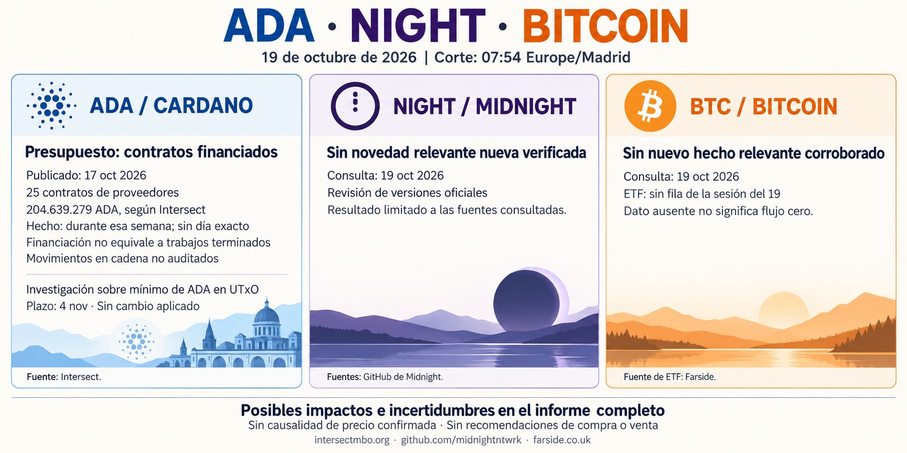

**Informe diario de ADA, NIGHT y Bitcoin — 19 de octubre de 2026**

Corte documental: **07:54, Europe/Madrid**. Se incluyen novedades aún no recogidas en la edición anterior, conservando sus fechas reales.

**ADA — Contratos financiados del presupuesto de 2026**

En su actualización del **17 de octubre**, Intersect declara que todos los proyectos financiados del presupuesto de 2026 ya cuentan con contratos en cadena: **25 contratos de proveedores por 204.639.279 ADA**. El último, del comité técnico, recibió financiación esa semana; no se precisa el día. [Comunicado original de Intersect](https://www.intersectmbo.org/news/intersect-weekly-update-133-oct-17-2026).

Puede mejorar la trazabilidad. **Financiación no equivale a trabajos terminados ni pagos completos.** El panel dinámico no permitió leer sus datos; no se han auditado los movimientos en cadena.

La misma publicación anuncia una convocatoria para investigar cuánto podría reducirse de forma segura **utxoCostPerByte**, el parámetro del mínimo de ADA exigido en un UTxO. El plazo de propuestas termina el **4 de noviembre**. **Es una investigación, no una reducción ya aprobada o aplicada.** Su posible impacto depende de los resultados y de posteriores decisiones de gobernanza.

**NIGHT — Sin novedad relevante nueva verificada**

No he localizado una novedad fundamental nueva verificable posterior a la versión candidata ya recogida en el informe anterior. La revisión incluye los listados oficiales de versiones del nodo y de midnight-js. Es una conclusión limitada a las fuentes consultadas; no demuestra ausencia global de anuncios ni permite atribuir movimientos de precio a una causa concreta. [Versiones del nodo](https://github.com/midnightntwrk/midnight-node/releases), [versiones de midnight-js](https://github.com/midnightntwrk/midnight-js/releases).

**Bitcoin — Sin nuevo hecho relevante corroborado al corte**

La búsqueda no ha aportado una noticia relevante nueva suficientemente corroborada desde la edición anterior. La tabla de Farside consultada **todavía no contiene una fila para la sesión del 19 de octubre**. **La ausencia de dato no equivale a un flujo de cero.** No se presenta otra vez el saldo de la sesión del 16 como novedad de hoy. [Tabla de Farside](https://farside.co.uk/btc/).

Sin nuevos datos verificados, no se establece un impacto adicional sobre BTC. No se incluyen cotizaciones actuales de los tres activos ni recomendaciones de compra o venta.
