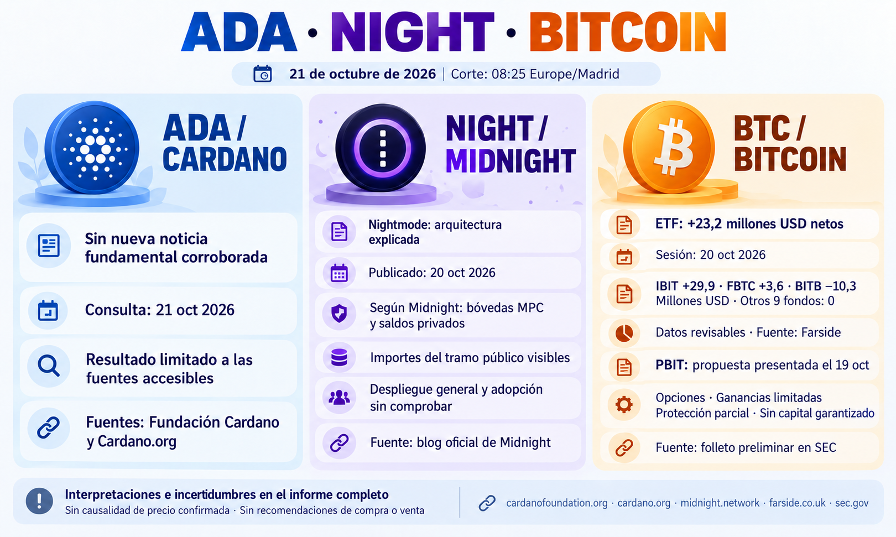

**Informe diario de ADA, NIGHT y Bitcoin — 21 de octubre de 2026**

Corte documental: **08:25, Europe/Madrid**. Se distinguen la fecha de publicación y la del hecho; los datos de ETF son revisables.

**ADA — Sin nueva noticia fundamental corroborada**

No he verificado una novedad fundamental relevante desde la edición anterior en las fuentes accesibles. La revisión incluye el [blog de la Fundación Cardano](https://cardanofoundation.org/blog) y el [archivo oficial de noticias](https://cardano.org/news/archive/). Es una conclusión limitada a la búsqueda, no una ausencia global de noticias; no permite identificar un impacto nuevo sobre ADA.

**NIGHT — Midnight explica la arquitectura de Nightmode**

En una publicación del **20 de octubre**, Midnight describe Nightmode: los activos permanecen en bóvedas MPC de la red de origen y se representan mediante saldos privados en Midnight. Según el proyecto, la ejecución busca desvincular la identidad del usuario, pero **los importes del intercambio en el tramo público siguen visibles**. [Publicación oficial de Midnight](https://midnight.network/blog/nightmode-enables-cross-chain-privacy).

Podría ampliar los usos de privacidad entre redes y el uso de DUST, generado por NIGHT. **La publicación no demuestra por sí sola disponibilidad general, adopción o seguridad auditada**; no fija aquí una fecha verificable de despliegue. Es una descripción del proyecto, no una garantía de privacidad absoluta ni de demanda del token.

**Bitcoin — Nuevos flujos de ETF y propuestas institucionales**

Para la **sesión estadounidense del 20 de octubre**, Farside publica **+23,2 millones de USD** netos: IBIT **+29,9 millones**, FBTC **+3,6 millones** y BITB **−10,3 millones**; los otros nueve fondos figuran en cero. La suma de las doce columnas coincide. La consulta es del 21; el proveedor no precisa cuándo publicó la fila. [Tabla de Farside](https://farside.co.uk/btc/).

Son entradas netas en los fondos cubiertos, **revisables y sin conciliación con cada emisor**. Una sesión no confirma una tendencia ni explica por sí sola el movimiento de BTC.

BlackRock presentó el **19 de octubre** documentación preliminar para **iShares Bitcoin Managed Protection ETF (PBIT)**. La propuesta emplearía opciones y renta fija para ofrecer exposición con ganancias limitadas y protección parcial frente a pérdidas. **No invierte directamente en BTC y no constituye un lanzamiento aprobado ni una garantía de capital.** Si llega a operar, ampliaría las formas de exposición; no acredita compras actuales de bitcoin. [Registro de presentación](https://www.sec.gov/Archives/edgar/data/1100663/000119312526425335/0001193125-26-425335-index.htm) y [folleto preliminar](https://www.sec.gov/Archives/edgar/data/1100663/000119312526425335/d144515d485apos.htm).

También se ha contrastado el comunicado de **J.P. Morgan Asset Management del 19 de octubre**, difundido por medios el 20: incorpora un rango de previsiones para Bitcoin a su estudio de largo plazo, pero **no lo incluye como asignación de cartera**. Puede influir en el debate institucional; no es una entrada de capital ni un rendimiento garantizado. [Comunicado original](https://am.jpmorgan.com/us/en/asset-management/adv/about-us/media/press-releases/jp-morgan-releases-2027-long-term-capital-market-assumptions/) y [cobertura del 20](https://decrypt.co/381464/jpmorgan-bitcoin-forecast-first-time-stocks-gold).

No se incluyen cotizaciones actuales ni recomendaciones de compra o venta.
