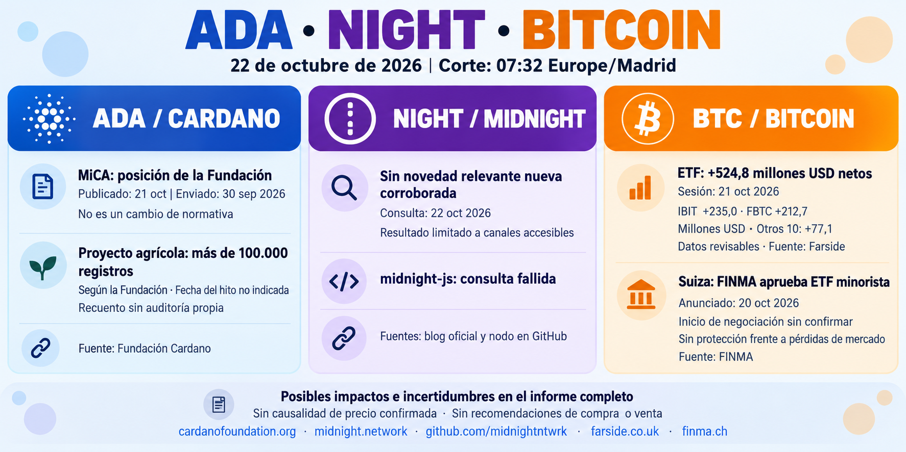

**Informe diario de ADA, NIGHT y Bitcoin — 22 de octubre de 2026**

Corte documental: **07:32, Europe/Madrid**. Se incluyen novedades aún no recogidas, conservando las fechas de los hechos y de su publicación.

**ADA — Posición sobre MiCA y registros agrícolas**

La Fundación Cardano publicó el **21 de octubre** una explicación de su respuesta a la consulta europea sobre MiCA, **presentada el 30 de septiembre**. Defiende regular según las funciones y riesgos, distinguir participación directa en el protocolo de servicios con intermediarios y evitar ampliar el perímetro por el mero uso de tecnología descentralizada. **Es una posición de la Fundación, no una modificación de la normativa.** Podría influir en el debate regulatorio; su aceptación y efecto sobre el ecosistema siguen pendientes. [Publicación original, Benjamin Buergi](https://cardanofoundation.org/blog/mica-review-consultation-response).

La ficha oficial del proyecto con **Syngenta Foundation India** declara **más de 100.000 explotaciones registradas en cadena**, con despliegue en mainnet y pruebas iniciales completados. La página no muestra fecha de publicación ni el día exacto en que se alcanzó el hito. Puede facilitar la verificación de datos agrícolas para financiación y seguros, pero **no se ha auditado aquí el recuento ni demostrado que esos registros equivalgan a títulos legales, préstamos o ingresos conseguidos**. [Caso de uso de la Fundación](https://cardanofoundation.org/case-studies/syngenta-india).

**NIGHT — Sin nueva noticia relevante corroborada**

No he corroborado una novedad fundamental posterior a lo recogido ayer. Se revisaron el [blog oficial](https://midnight.network/blog) y las [versiones del nodo](https://github.com/midnightntwrk/midnight-node/releases); la consulta de midnight-js falló por tiempo de espera. El resultado se limita a los canales accesibles. No se repite Nightmode como anuncio nuevo ni se establece un impacto adicional sobre NIGHT.

**Bitcoin — Entradas de ETF y aprobación en Suiza**

Para la **sesión estadounidense del 21 de octubre**, Farside publica **+524,8 millones de USD** de entradas netas en ETF al contado. IBIT aporta **+235,0 millones** y FBTC **+212,7 millones**; los restantes diez fondos suman **+77,1 millones**. Las doce cifras están presentes y su suma coincide con el total. La consulta es del 22; la hora exacta de publicación no figura. [Tabla de Farside](https://farside.co.uk/btc/).

Son datos **revisables y sin conciliación con cada emisor**. Reflejan exposición neta mediante esos fondos durante esa sesión; no confirman continuidad ni una causa concreta del precio de BTC.

FINMA anunció el **20 de octubre** la aprobación del primer ETF suizo para minoristas que invierte directamente en Bitcoin, con una excepción a las reglas de diversificación. La noticia amplía las vías reguladas de acceso, pero **no demuestra entradas efectivas ni implica protección frente a pérdidas de mercado**. El comunicado no permite confirmar aquí la fecha de inicio de negociación. [Anuncio original de FINMA](https://www.finma.ch/en/news/2026/10/20261020-mm-finma-bitcoin-etf).

No se incluyen cotizaciones actuales ni recomendaciones de compra o venta.
