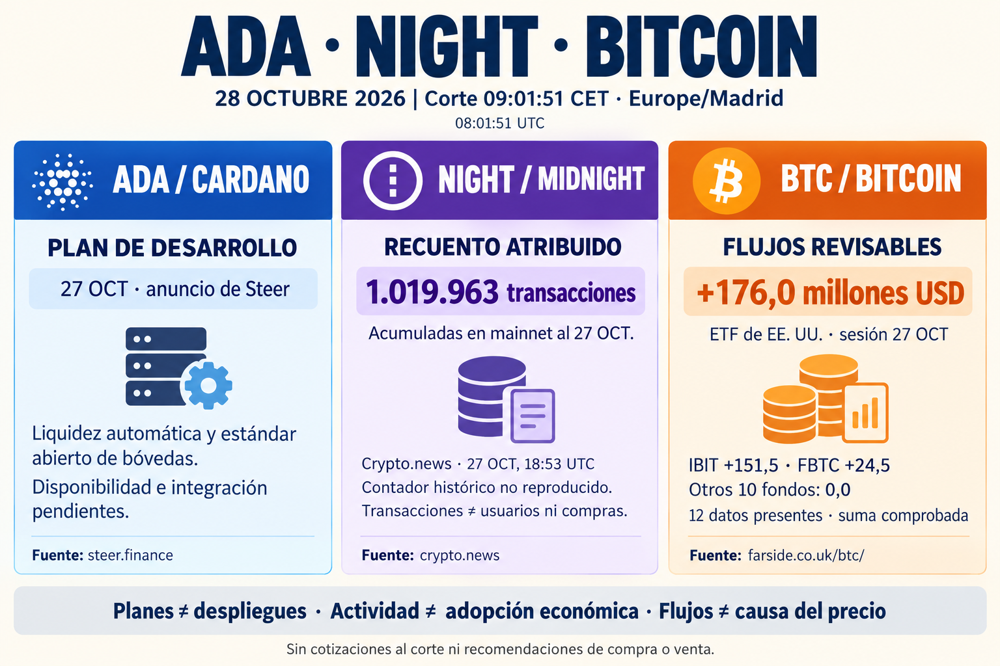

**Informe diario de ADA, NIGHT y Bitcoin — 28 de octubre de 2026**

**Corte: 09:01:51, Europe/Madrid (08:01:51 UTC).** Las novedades corresponden a anuncios y a la sesión bursátil del día 27; no se presentan como hechos ocurridos esta mañana.

**ADA — Steer anuncia su expansión a Cardano.** El 27 de octubre, Steer publicó sus planes para llevar a Cardano la gestión automática de liquidez mediante Smart Pools y colaborar en un estándar abierto de bóvedas tokenizadas. Es un anuncio de desarrollo: los detalles de integración y disponibilidad se comunicarán conforme avance el trabajo. El posible impacto es facilitar estrategias de liquidez e interfaces comunes entre aplicaciones. Aún no acredita una integración operativa, un estándar adoptado ni capital captado; tampoco permite cuantificar demanda adicional de ADA. [Anuncio de Steer](https://www.steer.finance/blog/steer-protocol-expands-to-cardano).

**NIGHT — Midnight supera el millón de transacciones, según el recuento divulgado.** Crypto.news, en un artículo publicado el 27 a las **18:53 UTC —19:53 en Madrid—**, recoge un anuncio de Input Output Group y del explorador: **1.019.963 transacciones acumuladas** en mainnet al 27 de octubre. Es una señal declarada de actividad de red, cuyo posible valor depende del uso que representen esas operaciones. No equivale a un millón de usuarios, ingresos o compras de NIGHT. No he podido reproducir el contador histórico ni leer directamente la publicación de X, bloqueada con HTTP 403; la cifra se conserva atribuida al medio, no como medición independiente. [Artículo de Crypto.news](https://crypto.news/midnight-mainnet-one-million-transactions/).

La documentación oficial identifica Midnight Explorer como una herramienta comunitaria mantenida por TexLabs y advierte de que esos proyectos no tienen soporte oficial y podrían no estar auditados. El explorador accesible no mostró cifras legibles en esta consulta. Siguen faltando un desglose de aplicaciones y usuarios activos que permita valorar la adopción económica. [Documentación oficial](https://docs.midnight.network/sdks/community), [explorador](https://midnightexplorer.com/).

**Bitcoin — Entradas netas de 176,0 millones de USD en ETF estadounidenses.** Para la **sesión del 27 de octubre**, Farside muestra **IBIT +151,5 millones** y **FBTC +24,5 millones de USD**; los otros diez fondos figuran a cero. Las doce celdas están presentes y su suma coincide con el total. Consulta realizada el 28; la tabla no indica la hora exacta de publicación. Estas entradas reflejan demanda a través de esos vehículos durante esa sesión. Son datos revisables, sin conciliación individual con los emisores, y no demuestran por sí solos una tendencia ni la causa de un movimiento del precio. [Tabla de Farside](https://farside.co.uk/btc/).

**Lectura del día.** Cardano incorpora un plan de infraestructura DeFi; Midnight, un hito de actividad divulgado con verificación pendiente; Bitcoin, entradas de capital observadas en ETF. Se distinguen planes, recuentos atribuidos y flujos revisables. No se incluyen cotizaciones sin una captura comparable ni recomendaciones de compra o venta.

