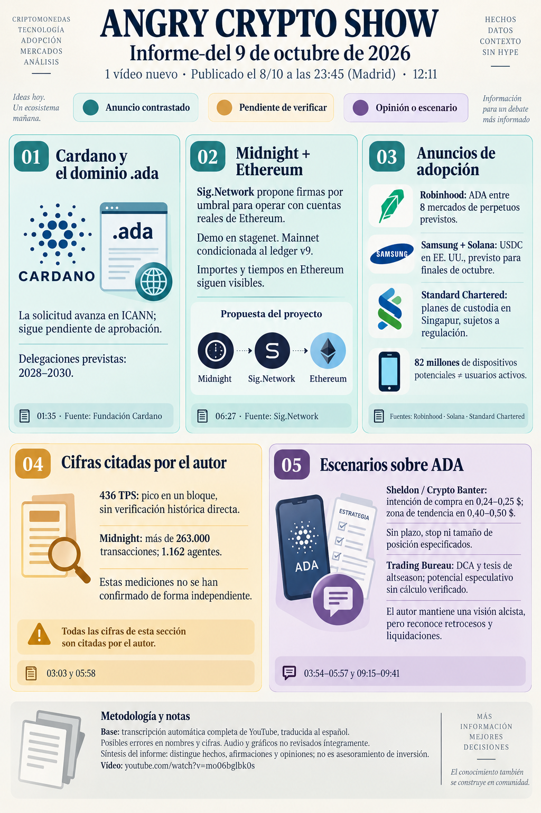

# Angry Crypto Show — síntesis del 9 de octubre de 2026

**Fecha del informe original: 9 de octubre. Ingesta: 14 de octubre de 2026.** [Original íntegro](../../raw/notes/2026-10-09-informe-angry-crypto-show.md) · [Procedencia y transcripción](../sources/2026-10-09-informe-angry-crypto-show.md). El vídeo se publicó el 8 de octubre de 2026, 23:45, Madrid; metadatos del archivo. No es un informe nuevo de noticias del 14 ni una fuente primaria de los hechos externos.

## Noticias y contexto

El avance de .ada y el contexto de CIP-0113 se conectan con las fichas ya incorporadas. El informe describe el anuncio de Robinhood del 29 de septiembre como lanzamiento previsto, no como novedad del 8 ni prueba de contratos de CME. Sig.Network se presenta según su propia web: demo en stagenet y mainnet condicionada al ledger v9.

## Afirmaciones pendientes y límites

El pico citado de 436 TPS en un bloque, más de 263.000 transacciones de Midnight y los recuentos de agentes son mediciones atribuidas que no se reconstruyeron. La visibilidad del tramo público de Ethereum limita la expresión «ETH privado»; no se comprueba aquí una integración productiva.

## Opiniones, recomendaciones y publicidad atribuidas

Sheldon, de Crypto Banter: intención de compra en 0,24–0,25 USD y zona de tendencia de 0,40–0,50 USD para ADA. El informe no identifica horizonte, stop, tamaño de posición ni una orden inequívoca de venta en la segunda zona. La tesis de Trading Bureau y su potencial de rentabilidad quedan como escenarios de terceros, no cálculo validado ni pauta propia.

## Relaciones y continuidad

[Dominio .ada](../concepts/dominio-ada-y-aprobacion-icann.md) · [Sig.Network](../entities/sig-network.md) · [Leios y TPS](../concepts/leios-testnet-y-mainnet.md) · [Previsiones](../concepts/previsiones-atribuidas-y-publicidad.md).

[Cardano / ADA](../entities/cardano-ada.md) · [Midnight / NIGHT](../entities/midnight-night.md) · [Bitcoin](../entities/bitcoin-btc.md) · [Canal Angry Crypto Show](../entities/angry-crypto-show.md) · [Seguimiento del lote](../topics/seguimiento-angry-crypto-show.md) · [Índice de informes](index.md).
