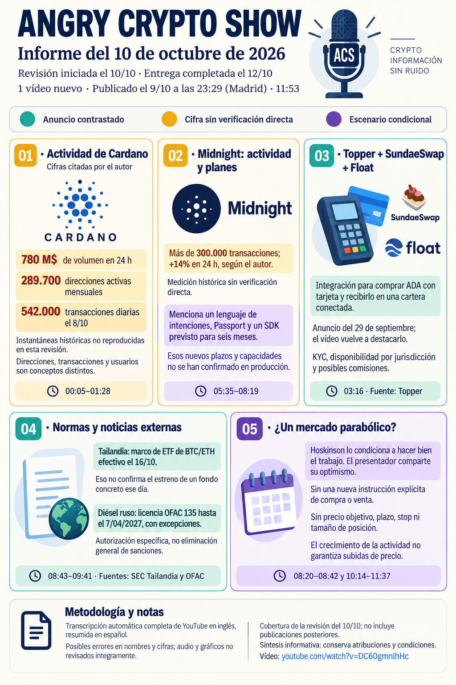

# Angry Crypto Show — síntesis del 10 de octubre de 2026

**Fecha del informe original: 10 de octubre. Ingesta: 14 de octubre de 2026.** [Original íntegro](../../raw/notes/2026-10-10-informe-angry-crypto-show.md) · [Procedencia y transcripción](../sources/2026-10-10-informe-angry-crypto-show.md). El vídeo se publicó el 9 de octubre de 2026, 23:29, Madrid; metadatos del archivo. No es un informe nuevo de noticias del 14 ni una fuente primaria de los hechos externos.

**Fechas separadas:** revisión del día 10, preparación del informe y de la imagen el 12, envío efectivo el 13 a las 07:55 de Madrid según la constancia archivada. La fecha de la imagen corresponde a preparación; no amplía la cobertura al día 12 ni constituye la fecha del envío.

## Noticias y contexto

El informe separa la integración Topper–SundaeSwap/Float anunciada el 29 de septiembre del momento en que el vídeo la vuelve a destacar. El contraste histórico de Passport solo respalda la existencia de ese proyecto, no todos los plazos y garantías posteriores relatados.

## Afirmaciones pendientes y límites

Direcciones mensuales/diarias, transacciones, AUM de productos llamados ETF de ADA y ADA representado en otras redes son métricas distintas, sin ventanas reproducidas. No acreditan un ETF estadounidense de ADA. El nombre Moriarty es una interpretación de subtítulos variables; no se obtuvo especificación contemporánea que pruebe sus garantías o disponibilidad.

## Opiniones, recomendaciones y publicidad atribuidas

La previsión de Hoskinson de crecimiento «parabólico» está condicionada a que el equipo haga bien su trabajo. El presentador coincide, pero no aporta una nueva orden cuantificada de comprar/vender, precio objetivo, fecha, stop o tamaño de posición. Se omiten las cotizaciones ambiguas; los planes de agentes, identidad y pagos no se convierten en resultados actuales.

## Relaciones y continuidad

[Métricas](../concepts/metricas-de-uso-y-adopcion.md) · [Roadmap de Midnight](../concepts/roadmap-midnight-y-staking-night.md) · [Previsiones](../concepts/previsiones-atribuidas-y-publicidad.md).

[Cardano / ADA](../entities/cardano-ada.md) · [Midnight / NIGHT](../entities/midnight-night.md) · [Bitcoin](../entities/bitcoin-btc.md) · [Canal Angry Crypto Show](../entities/angry-crypto-show.md) · [Seguimiento del lote](../topics/seguimiento-angry-crypto-show.md) · [Índice de informes](index.md).
