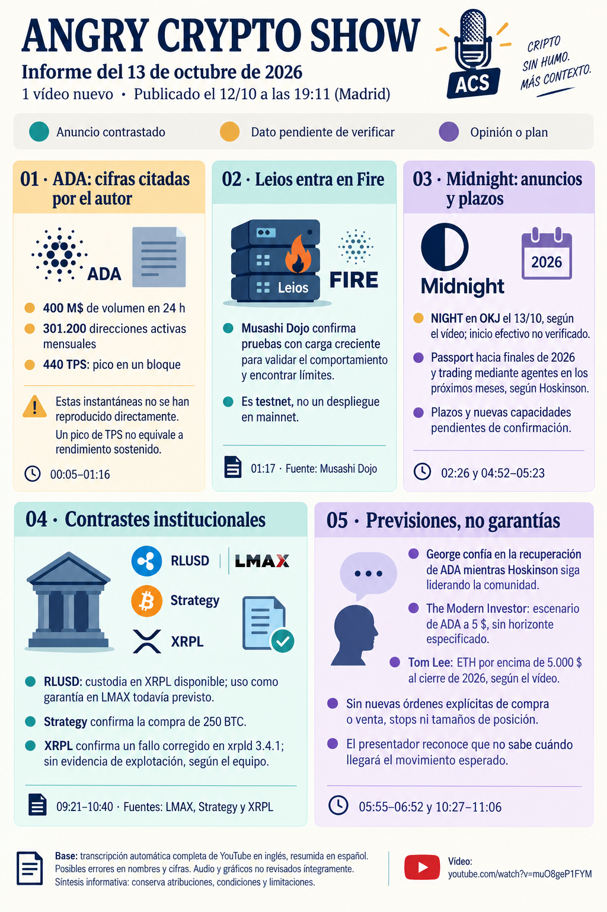

# Angry Crypto Show — síntesis del 13 de octubre de 2026

**Fecha del informe original: 13 de octubre. Ingesta: 14 de octubre de 2026.** [Original íntegro](../../raw/notes/2026-10-13-informe-angry-crypto-show.md) · [Procedencia y transcripción](../sources/2026-10-13-informe-angry-crypto-show.md). El vídeo se publicó el 12 de octubre de 2026, 19:11, Madrid; metadatos del archivo. No es un informe nuevo de noticias del 14 ni una fuente primaria de los hechos externos.

## Noticias y contexto

El informe declara contraste con Musashi Dojo para Fire. La wiki conserva una ficha primaria posterior que permite conectar esa fase de testnet sin convertirla en despliegue de mainnet. La compra de 250 BTC de Strategy del comunicado del 12 es distinta de las compras de Strive recogidas en el seguimiento diario del 14.

## Afirmaciones pendientes y límites

El pico de 440 TPS, direcciones y volumen de ADA no se reconstruyeron. Passport hacia finales de 2026, funciones sucesivas en 2027 y negociación mediante agentes son plazos atribuidos a ponentes. El vídeo anuncia NIGHT en OKJ el 13; el informe no verificó el comienzo operativo. La ficha del comunicado de OKCoin Japan ya incorporada conserva el horario previsto y sus límites.

## Opiniones, recomendaciones y publicidad atribuidas

George vincula su confianza en la recuperación a liderazgo y comunidad; «siempre vuelve» no es garantía de recuperar pérdidas. The Modern Investor plantea ADA a 5 USD y BTC a 295.000 USD sin horizonte, probabilidad o gestión del riesgo especificados. Las restantes opiniones no incluyen una nueva pauta exacta de inversión. El informe original conserva el contexto de otros activos y noticias externas.

## Relaciones y continuidad

[Leios](../concepts/leios-testnet-y-mainnet.md) · [Anuncio de OKJ](../sources/2026-10-13-night-okj.md) · [Roadmap de Midnight](../concepts/roadmap-midnight-y-staking-night.md) · [Previsiones](../concepts/previsiones-atribuidas-y-publicidad.md).

[Cardano / ADA](../entities/cardano-ada.md) · [Midnight / NIGHT](../entities/midnight-night.md) · [Bitcoin](../entities/bitcoin-btc.md) · [Canal Angry Crypto Show](../entities/angry-crypto-show.md) · [Seguimiento del lote](../topics/seguimiento-angry-crypto-show.md) · [Índice de informes](index.md).
