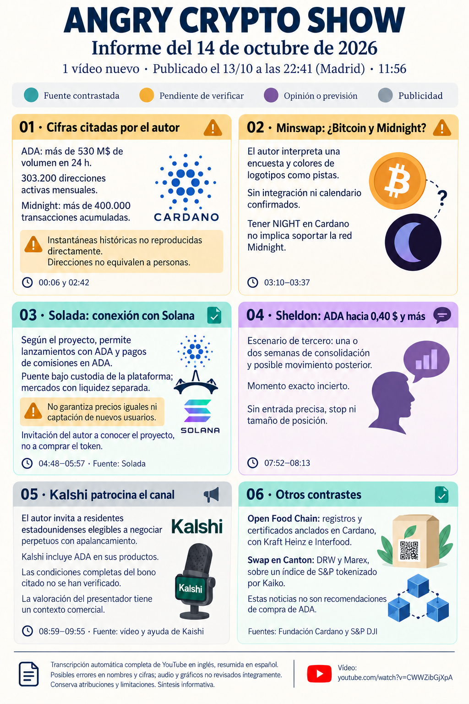

# Angry Crypto Show — síntesis del 14 de octubre de 2026

**Fecha del informe original: 14 de octubre. Ingesta: 14 de octubre de 2026.** [Original íntegro](../../raw/notes/2026-10-14-informe-angry-crypto-show.md) · [Procedencia y transcripción](../sources/2026-10-14-informe-angry-crypto-show.md). El vídeo se publicó el 13 de octubre de 2026, 22:41, Madrid; metadatos del archivo. No es un informe nuevo de noticias del 14 ni una fuente primaria de los hechos externos.

## Noticias y contexto

El informe contrasta Open Food Chain con un artículo del 30 de septiembre y describe el modelo de Solada según su propia web: reservas bajo custodia, mercados separados y precios que pueden diferir. La compra de Strive se enlaza con la ficha primaria ya incorporada en la wiki; el contraste secundario del informe corrige los 275 millones redondeados del vídeo hacia unos 280.

## Afirmaciones pendientes y límites

Soporte de Bitcoin y de la red Midnight en Minswap se deduce de encuesta/colores como hipótesis del autor, no de un anuncio de integración confirmado. Negociación de NIGHT en OKJ se presenta ahora como activa según el vídeo, sin comprobación operativa independiente. Cifras de actividad, agentes y potenciales usuarios de Pump.fun no se convierten en adopción o fondos captados por Solada.

## Opiniones, recomendaciones y publicidad atribuidas

Sheldon: visión de compra y objetivo de 0,40 USD o más, con consolidación posible de una o dos semanas y momento incierto. El informe no identifica entrada exacta, stop o exposición; no hereda automáticamente los niveles del día 9. Conocer Solada es la acción propuesta por el autor, no una orden de comprar su token. Kalshi se declara patrocinador: la invitación comercial para residentes elegibles de EE. UU. y sus incentivos son publicidad; condiciones y vigencia no comprobadas íntegramente.

## Relaciones y continuidad

[Minswap](../entities/minswap.md) · [Solada](../entities/solada.md) · [Interoperabilidad y custodia](../concepts/interoperabilidad-custodia-y-privacidad.md) · [Previsiones y publicidad](../concepts/previsiones-atribuidas-y-publicidad.md) · [Strive: declaración primaria](../sources/2026-10-14-strive-compras-bitcoin.md).

[Cardano / ADA](../entities/cardano-ada.md) · [Midnight / NIGHT](../entities/midnight-night.md) · [Bitcoin](../entities/bitcoin-btc.md) · [Canal Angry Crypto Show](../entities/angry-crypto-show.md) · [Seguimiento del lote](../topics/seguimiento-angry-crypto-show.md) · [Índice de informes](index.md).
