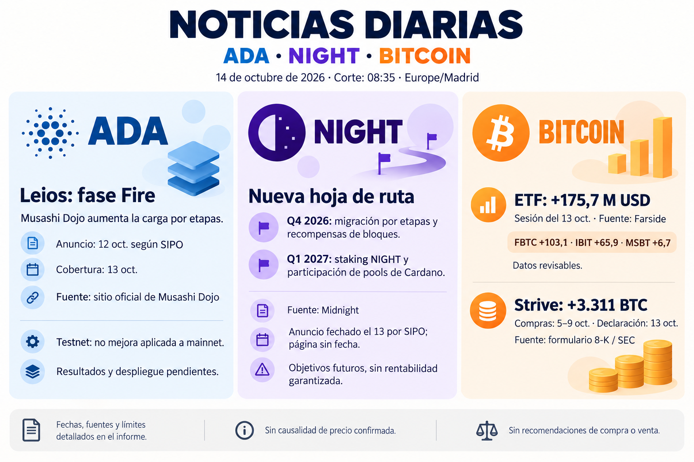

# Seguimiento de ADA, NIGHT y Bitcoin — 14 de octubre de 2026

## Alcance y conservación

Corte 08:35 Europe/Madrid. [Informe íntegro](../../raw/reports/2026-10-14-informe-ada-night-bitcoin.md), [metadatos](../../raw/reports/2026-10-14-informe-ada-night-bitcoin-metadatos.md), [fuentes](../sources/2026-10-14-informe-ada-night-bitcoin.md), [prompt y procedencia visual](../../raw/images/2026-10-14-infografia-ada-night-bitcoin-metadatos.json). Bitcoin permanece por solicitud expresa en los informes; el alcance general sigue ADA/NIGHT.

## Síntesis

- [Leios](../sources/2026-10-14-cardano-leios-fire.md): Fire confirmado en página primaria; anuncio del 12 atribuido a SIPO del 13. Pruebas de carga, no despliegue de mainnet ni rendimiento propio comprobado.
- [NIGHT](../sources/2026-10-14-midnight-roadmap.md): roadmap oficial Q4/Q1; staking en Q1 2027. Sin fecha propia de página; difusión del 13 según SIPO del 14, post X inaccesible. Plan, no disponibilidad actual.
- [ETF](../sources/2026-10-14-farside-flujos-bitcoin.md): sesión del 13 +175,7 millones de USD; doce valores presentes, suma comprobada, revisables.
- [Strive](../sources/2026-10-14-strive-compras-bitcoin.md): declaración primaria del 13, compras del 5–9 de 3.311 BTC y saldo de 32.773 BTC al 9. Ventana distinta de ETF.

## Límites y continuidad

Sin cotizaciones simultáneas, causalidad de precio o rentabilidad garantizada. [Informe anterior](2026-10-13-seguimiento-ada-night-bitcoin.md) conservado sin cambios. [Leios y mainnet](../concepts/leios-testnet-y-mainnet.md), [staking y roadmap](../concepts/roadmap-midnight-y-staking-night.md), [Cardano](../entities/cardano-ada.md), [Midnight](../entities/midnight-night.md), [Bitcoin](../entities/bitcoin-btc.md) y [seguimiento](../topics/seguimiento-mercado-ada-night.md).

## Entrega

[Envío verificado](../../raw/notes/2026-10-14-envio-gmail-informe-ada-night-bitcoin.json), 08:50:43 Europe/Madrid, a gallegojc@gmail.com. Se comprobó el mensaje enviado, ambos cuerpos y la identidad del PNG. Sin cambiar la programación diaria.
