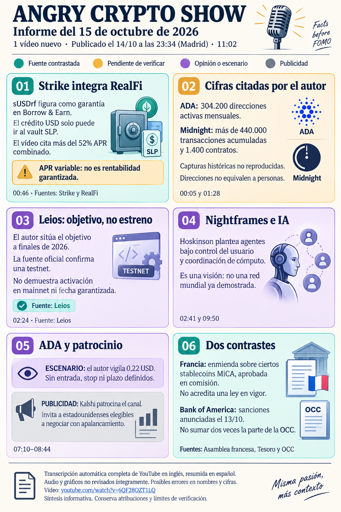

# Angry Crypto Show — síntesis del 15 de octubre de 2026

**Informe del 15, corte 08:30 Europe/Madrid; vídeo publicado el 14 a las 23:34:07. Ingesta: 16 de octubre.** [Original íntegro](../../raw/notes/2026-10-15-informe-angry-crypto-show.md) · [Ficha, transcripción, fuentes y fechas](../sources/2026-10-15-informe-angry-crypto-show.md). Fuente derivada de un canal de opinión, sin nueva verificación primaria externa en esta ingesta.

## Novedad y contraste declarado

[Strike](../entities/strike-finance.md) incorpora sUSDrf de [RealFi](../entities/realfi.md) entre las garantías visibles en su interfaz, según la consulta del autor del informe del 15. El canal cita APR combinado >52 %; la lectura posterior de la interfaz del autor fue 54,10 %. Son momentos y lecturas distintos, sin retorno realizado o garantizado. El crédito se dirige al vault SLP según la documentación recogida, con deuda en USD y exposición a pérdidas, recuperación de garantía, crédito y liquidez. [Mecanismo y límites](../concepts/apr-credito-y-liquidez.md) · [Fuentes externas y atribución](../sources/2026-10-15-informe-angry-crypto-show.md).

Leios repite testnet ya documentada; el objetivo de hard fork a finales de 2026 y el contador de >6.800 actualizaciones son atribuciones del canal, sin activación actual o plazo garantizado. Nightframes se presenta como visión de agentes y cómputo compartido, sin red mundial demostrada. [Leios: etapas](../concepts/leios-testnet-y-mainnet.md) · [Planes de Midnight](../concepts/roadmap-midnight-y-staking-night.md).

## Métricas y alegaciones pendientes

El canal cita ADA hasta 530 millones USD/24 h y 304.200 direcciones activas mensuales; Midnight >1.400 contratos, >440.000 transacciones y +10 % en 24 h; RealFi >7,6 millones emitidos y >5,1 millones de TVL. Son instantáneas sin series reconstruidas. Contratos no son los agentes de Midnight City, direcciones no son personas y emisión no se suma a TVL como otro capital. [Cifras, ventanas y fuentes](../sources/2026-10-15-informe-angry-crypto-show.md) · [Métricas de uso](../concepts/metricas-de-uso-y-adopcion.md).

El contraste documentado por el informe matiza tres noticias externas: Francia es una enmienda aprobada en comisión, sin ley en vigor demostrada ni tasa general de 31,4 % acreditada por ese texto; las sanciones a Bank of America se anunciaron el 13 y el componente OCC no se cuenta dos veces; el comunicado de Standard Chartered es de septiembre, sin nuevo lanzamiento confirmado el 14. BNY/Citadel, Robinhood y la alegación personal sobre Richard Heart quedan sin comprobación suficiente. [Fuentes y lagunas](../sources/2026-10-15-informe-angry-crypto-show.md).

## Escenarios y publicidad

El presentador vigila **0,22 USD en ADA**, sin entrada, stop, objetivo de venta, tamaño o plazo; se omiten cotizaciones abreviadas ambiguas. No se arrastra la previsión de Sheldon del 14. Kalshi es patrocinador y su invitación apalancada se dirige a estadounidenses elegibles, con promoción no verificada íntegramente. El elogio de Strike no es una instrucción cuantificada de inversión. [Registro de previsiones y publicidad](../concepts/previsiones-atribuidas-y-publicidad.md).

## Archivo y continuidad

La ficha RAW registra preparación el 15 a las 08:34:38 y envío el 15 a las 12:09:26; la copia se recuperó y archivó el 16 a las 07:46:51, sin reenviar. Los estados iniciales sin entrega del original se conservan y se interpretan junto a los metadatos posteriores; esta ingesta no accede a Gmail.

[Informe anterior](2026-10-14-angry-crypto-show.md) · [Siguiente informe](2026-10-16-angry-crypto-show.md) · [Cardano](../entities/cardano-ada.md) · [Midnight](../entities/midnight-night.md) · [Seguimiento del canal](../topics/seguimiento-angry-crypto-show.md) · [Índice de informes](index.md).
