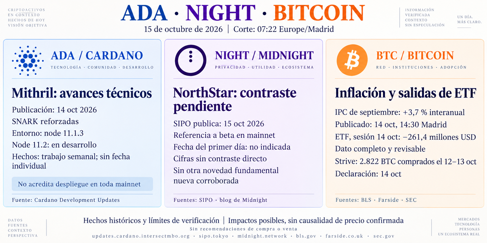

# Seguimiento de ADA, NIGHT y Bitcoin — 15 de octubre de 2026

## Alcance y procedencia

Corte documental: **07:22, Europe/Madrid**. Síntesis del [informe conservado en RAW](../../raw/reports/2026-10-15-informe-ada-night-bitcoin.md), con [metadatos](../../raw/reports/2026-10-15-informe-ada-night-bitcoin-metadatos.md) y [ficha de atribuciones, fechas y fuentes](../sources/2026-10-15-informe-ada-night-bitcoin.md). La copia se archivó a las 12:05:44; ese guardado posterior no cambia el corte. Bitcoin figura por el alcance expreso de este informe.

[Prompt y procedencia visual](../../raw/images/2026-10-15-infografia-ada-night-bitcoin-metadatos.json). Informe e imagen son derivados; esta ingesta no añade verificación primaria externa.

## Hechos y declaraciones recogidos

- **Cardano / ADA:** el informe atribuye a la actualización de [Mithril](../entities/mithril.md), publicada el 14, el refuerzo de primitivas SNARK y el entorno node **11.1.3**. Node **11.2** sigue en desarrollo; la investigación de fallos de verificación corresponde a **testing-preview**. Son avances semanales sin fecha individual de ejecución, sin acreditar despliegue general o un incidente de mainnet. [Procedencia y enlace oficial](../sources/2026-10-15-informe-ada-night-bitcoin.md).
- **Midnight / NIGHT:** [NorthStar](../entities/northstar.md) aporta una noticia atribuida a SIPO del 15: **1.014 transacciones, 283 intercambios y mediana de liquidación de 6 segundos** en su primer día de beta en mainnet. Fecha del primer día desconocida; X inaccesible al autor, sin reconstrucción en cadena. No se equiparan esas cifras a usuarios únicos o rendimiento de toda Midnight. La ausencia de otra novedad corroborada se limita a la búsqueda registrada. [Fuentes y límites](../sources/2026-10-15-informe-ada-night-bitcoin.md).
- **Bitcoin y macroeconomía:** el informe recoge IPC de **septiembre**, publicado el 14 a las **14:30 de Madrid**: **+0,6 % mensual y +3,7 % interanual**; subyacente **+0,3 % y +2,6 %**. Distingue el ajuste estacional de las tasas mensuales. La lectura de The Block del 14 a las 18:51 sitúa BTC bajo **82.000 USD**, con descenso aproximado del **2 %**; es histórica, no cotización del 15 al corte. [BLS, cobertura y atribución](../sources/2026-10-15-informe-ada-night-bitcoin.md).
- **ETF:** para la **sesión del 14**, la nota archivada de Farside conserva IBIT **−110,9**, FBTC **−152,7**, BITB **+2,2** y otros nueve fondos a **0,0**, en millones de USD. Suma recalculada: **−261,4**. Doce cifras presentes, publicación sin hora, valores revisables y sin conciliación con emisores. [Datos conservados](../../raw/notes/2026-10-15-fuentes-informe-ada-night-bitcoin.json) · [Criterio de interpretación](../concepts/flujos-etf-bitcoin.md).
- **Strive:** el informe recoge una declaración del **14** sobre compras de **2.822 BTC entre el 12 y el 13**, a promedio aproximado **83.266 USD/BTC**, incluidos comisiones y gastos. Es una adquisición distinta de la informada el día anterior sobre el 5–9; no se duplica ni se suma a los ETF como una misma medida de demanda. [Declaración referida y continuidad](../sources/2026-10-15-informe-ada-night-bitcoin.md).

## Interpretaciones y preguntas abiertas

El refuerzo de Mithril podría favorecer la robustez de esa infraestructura; no acredita capacidad o adopción de toda Cardano. La actividad atribuida a NorthStar puede indicar uso inicial de una aplicación, pero exige fuente primaria accesible, definición de métricas, fecha y datos verificables antes de generalizar. La inflación puede influir en activos de riesgo; no establece una causa única del precio de Bitcoin. [Métricas de uso y adopción](../concepts/metricas-de-uso-y-adopcion.md).

Pendientes: contraste directo de NorthStar y su ventana, conciliación de ETF con emisores y cotizaciones compatibles. No hay precios simultáneos de los tres activos ni recomendaciones de compra o venta. La [ficha de fuente](../sources/2026-10-15-informe-ada-night-bitcoin.md) distingue las consultas registradas por el autor de las comprobaciones locales de esta ingesta.

[Informe anterior, conservado](2026-10-14-seguimiento-ada-night-bitcoin.md) · [Cardano](../entities/cardano-ada.md) · [Midnight](../entities/midnight-night.md) · [Bitcoin](../entities/bitcoin-btc.md) · [Seguimiento](../topics/seguimiento-mercado-ada-night.md) · [Índice de informes](index.md).
