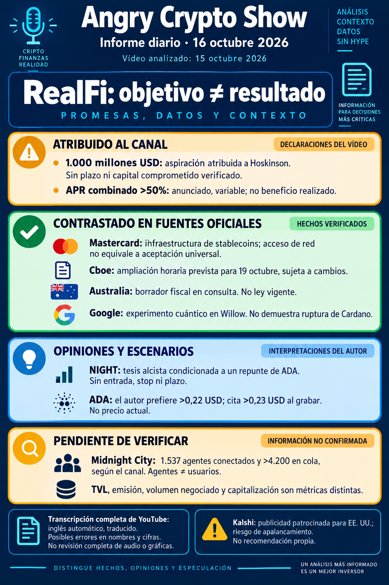

# Angry Crypto Show — síntesis del 16 de octubre de 2026

**Informe del 16, corte 07:35 Europe/Madrid; vídeo publicado el 15 a las 23:42:42. Ingesta: 16 de octubre.** [Original íntegro](../../raw/notes/2026-10-16-informe-angry-crypto-show.md) · [Ficha, transcripción y fuentes](../sources/2026-10-16-informe-angry-crypto-show.md). El informe es derivado; esta incorporación no vuelve a verificar las fuentes externas.

## Lo nuevo y lo repetido

El canal atribuye a Hoskinson una aspiración de **1.000 millones de USD** en el contexto de RealFi y TVL de Cardano. No acredita saldo alcanzado, capital comprometido, plazo o mecanismo. La integración [RealFi](../entities/realfi.md)/[Strike](../entities/strike-finance.md), el APR >50 % y las magnitudes de emisión/TVL se repiten del [informe del 15](2026-10-15-angry-crypto-show.md); no se cuentan como otra integración o capital nuevo. La mención de TxPipe y Nudu/Nudo sigue sin anuncios originales o movimientos en cadena contrastados. [Procedencia y fechas](../sources/2026-10-16-informe-angry-crypto-show.md).

Para Midnight, el trabajo y el anuncio «próximo» atribuidos a Hoskinson no equivalen a función entregada. El panel del 22 con IBM y CertiK tiene agenda pendiente de contraste; la relación anterior con CertiK no confirma una nueva alianza con IBM. Nightstream y las menciones cuánticas no prueban resistencia completa hoy ni ruptura de Cardano. [Planes y ejecución](../concepts/roadmap-midnight-y-staking-night.md).

## Métricas y discrepancias conservadas

- **ADA:** >500 millones USD/24 h y 305.300 direcciones mensuales según el canal. Frente a 304.200 citadas el 15, la diferencia aritmética es **1.100**, aunque el discurso diga 1.000; redondeo o cortes distintos no están comprobados.
- **NIGHT y Midnight:** >39.200 millones USD de volumen acumulado y >9.000 % de actividad, sin base/ventana reconstruida. Midnight City: **1.537 agentes conectados y >4.200 en cola**, no usuarios, contratos o validadores.
- **Perpetuos de ADA:** >900.000 USD atribuidos; discrepancia KuCoin/Kalshi entre subtítulos y descripción, sin plataforma resuelta como hecho.

Son afirmaciones del vídeo, no medidas independientes de esta wiki. Volumen, emisión, TVL, capitalización, contratos y agentes conservan definiciones separadas. [Ficha y tramos](../sources/2026-10-16-informe-angry-crypto-show.md) · [Métricas de uso y adopción](../concepts/metricas-de-uso-y-adopcion.md).

## Contexto externo contrastado por el autor

El informe registra fuentes oficiales para infraestructura de stablecoins de Mastercard, ampliación horaria prevista de Cboe el 19 y su lista de 25 acciones/5 ETF, consulta fiscal australiana del 15–28 y experimento cuántico de Google del 15. Esos contrastes acotan el discurso: acceso de red no es aceptación universal, una fecha prevista no es lanzamiento ya realizado, un borrador no es ley vigente y un experimento no prueba ruptura de una cadena. Binance B-stocks, Ripple y Robinhood conservan lagunas. [Enlaces, fechas y alcance](../sources/2026-10-16-informe-angry-crypto-show.md).

## Escenarios y publicidad

VirtualBacon plantea interés en NIGHT **si ADA repunta**, sin entrada, objetivo, stop o plazo. El presentador prefiere ADA >0,22 USD y observa >0,23 durante la grabación: datos históricos, sin señal operativa completa ni precio actual. Seguir RealFi/Strike es una opinión favorable, no orden de depósito. Kalshi se declara patrocinador; condiciones completas y disponibilidad para el lector no se verifican. No se hereda el objetivo de Sheldon de otros episodios. [Previsiones y publicidad](../concepts/previsiones-atribuidas-y-publicidad.md) · [APR, crédito y liquidez](../concepts/apr-credito-y-liquidez.md).

## Archivo y continuidad

Metadatos: preparado a las 07:36:00, envío registrado a las 07:45:48, verificación a las 07:46:06 y archivo/finalización a las 07:46:51, Europe/Madrid. Se conservan los hitos y el corte 07:35 sin equipararlos. El estado RAW `pending` no se reescribe; la incorporación posterior queda en el registro de la wiki. No se comprueba ni reenvía correo en esta ingesta.

[Informe anterior](2026-10-15-angry-crypto-show.md) · [Cardano](../entities/cardano-ada.md) · [Midnight](../entities/midnight-night.md) · [Seguimiento del canal](../topics/seguimiento-angry-crypto-show.md) · [Índice de informes](index.md).
