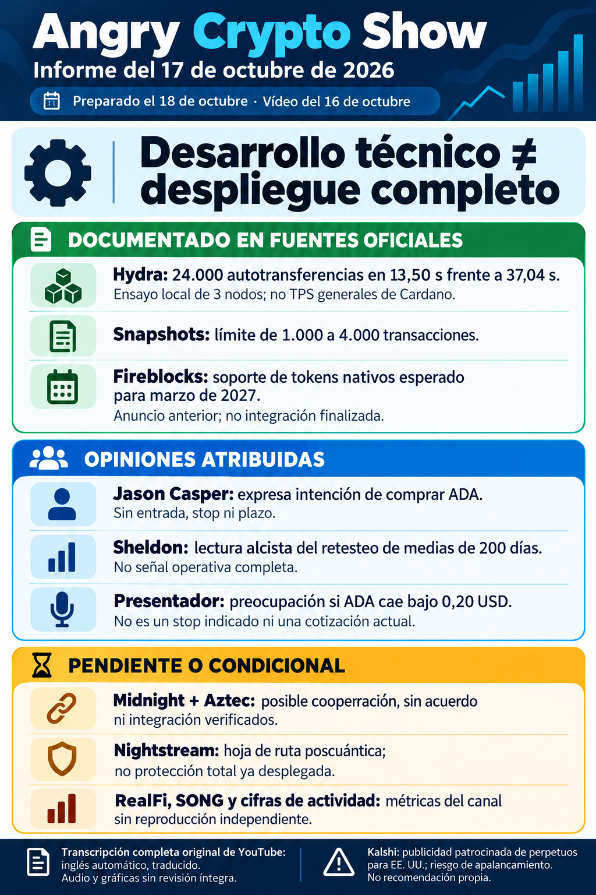

# Angry Crypto Show — síntesis del 17 de octubre de 2026

**Edición del 17; vídeo del 16; preparación y contraste del 18; envío/archivo e ingesta del 19.** Corte efectivo del original: **18 de octubre, 22:05 Europe/Madrid**. [Informe íntegro](../../raw/notes/2026-10-17-informe-angry-crypto-show.md) · [Ficha, transcripción, fuentes y fechas](../sources/2026-10-17-informe-angry-crypto-show.md). El informe es derivado; esta incorporación no vuelve a verificar las fuentes externas o el audiovisual íntegro.

## Desarrollo documentado por el autor

- **[Hydra](../entities/hydra.md):** el informe semanal del 16 recogido por el autor describe un ensayo **local de tres nodos**: **24.000 autotransferencias mínimas**, **13,50 segundos frente a 37,04**. El límite por snapshot pasa de **1.000 a 4.000**. Son magnitud, tiempo y límite distintos; no se convierten en TPS sostenidos de Cardano. [Fuente previa y continuidad](../sources/2026-10-17-cardano-desarrollo-leios-hydra.md) · [Condiciones del benchmark](../concepts/benchmarks-locales-y-rendimiento-red.md).
- **Leios y Peras:** forecasting/parámetros y manejo de claves BLS son trabajo en desarrollo. No prueban activación, y el calendario de Leios citado por el canal no se garantiza ni se asigna automáticamente a Peras. [Etapas y límites](../concepts/leios-testnet-y-mainnet.md).
- **[Fireblocks](../entities/fireblocks.md):** soporte completo de tokens nativos de Cardano esperado para **marzo de 2027**. El anuncio anterior no equivale a integración terminada, clientes que ya operan o capital captado.
- **[Nightstream](../entities/nightstream.md):** la roadmap consultada por el autor describe infraestructura ZK poscuántica prevista. No prueba protección total ya desplegada ni una alianza con Aztec. [Fuente y atribuciones](../sources/2026-10-17-informe-angry-crypto-show.md).

## Lo que sigue atribuido o hipotético

La posible cooperación **Midnight–Aztec** surge de un intercambio cordial relatado y de expectativas del presentador: **sin acuerdo, producto o integración confirmados**. La relación deseada con Ripple es aún más explícitamente hipotética. Cexplorer en Preview/Preprod, métricas iniciales, inversión multiplicada por 2,5 de una empresa de nombre ambiguo y capitalización/ventas de SONG no se han reproducido. No se suman capitalización y recaudación ni se infieren dólares desde un múltiplo sin base. RealFi–Strike se repite de informes anteriores, sin nuevo rendimiento realizado. [Tramos, fuentes y lagunas](../sources/2026-10-17-informe-angry-crypto-show.md).

El contexto externo también conserva límites: oferta elegible de Schwab no son millones de clientes que hayan comprado; comunicado anterior de Visa no demuestra disponibilidad uniforme de USDC en todos los países; custodia de Deutsche Bank y otras pruebas/plataformas no se convierten en servicios ya verificados.

## Escenarios y publicidad

Jason Casper expresa intención de comprar ADA sin entrada, tamaño, stop o plazo. Sheldon interpreta medias de 200 días como oportunidad, sin serie o señal exacta comprobada. El presentador se preocuparía bajo **0,20 USD**: **no lo indica como stop de venta**. Tim Warren formula una hipótesis sobre Midnight y ADA, sin causalidad demostrada. Las cotizaciones ambiguas no se reconstruyen; Kalshi se registra como patrocinador, sin recomendar el producto al lector. [Previsiones, campos ausentes y publicidad](../concepts/previsiones-atribuidas-y-publicidad.md).

## Archivo y continuidad

Los metadatos registran preparación el 18 a las **23:37:26**, envío el 19 a las **07:25:51**, verificación a las **07:26:20** y archivo/finalización a las **07:26:36**, Europe/Madrid. El fallo de conexión y los estados pendientes pertenecen a esos registros históricos; no se reescriben ni se reenvía correo en esta ingesta.

[Informe anterior del canal](2026-10-16-angry-crypto-show.md) · [Seguimiento de Angry](../topics/seguimiento-angry-crypto-show.md) · [Cardano](../entities/cardano-ada.md) · [Midnight](../entities/midnight-night.md) · [Índice de informes](index.md).
