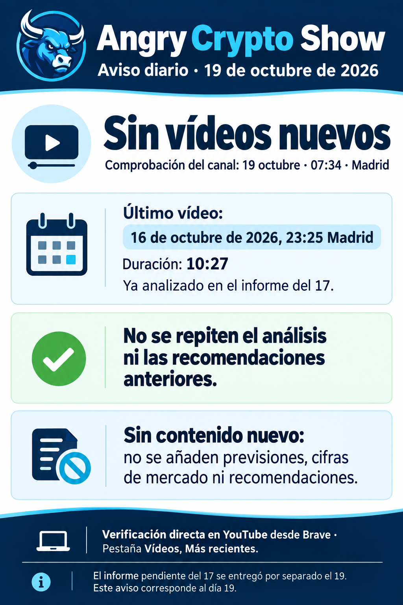

# Angry Crypto Show — 19 de octubre: revisión sin vídeos nuevos

**Estado registrado por el autor a las 07:34 Europe/Madrid del 19 de octubre de 2026: sin vídeos nuevos en la pestaña Vídeos, orden Más recientes.** [Aviso original](../../raw/notes/2026-10-19-informe-angry-crypto-show.md) · [Procedencia y fechas](../sources/2026-10-19-aviso-angry-sin-videos-nuevos.md).

El último vídeo de aquella revisión seguía siendo el publicado el 16 a las 23:25:40 de Madrid, ya incorporado en el [informe correspondiente al 17](2026-10-17-angry-crypto-show.md). Este registro no lo vuelve a analizar ni añade noticias, cifras de mercado, previsiones o recomendaciones. No existe transcripción nueva porque no se identificó contenido nuevo.

La conclusión se limita a la comprobación documentada por el autor; esta ingesta no vuelve a abrir el canal ni garantiza ausencia de publicaciones futuras. El seguimiento conserva **nueve análisis de vídeo y este aviso de estado**, con funciones distintas.

Los metadatos registran preparación a las 07:38:07, envío a las 07:39:35, verificación a las 07:40:12 y archivo a las 07:40:47. Se conservan los originales y sus estados históricos pendientes; no se reenvía el informe atrasado ni este aviso, ni se consulta Gmail desde esta operación.

[Seguimiento del canal](../topics/seguimiento-angry-crypto-show.md) · [Índice de informes](index.md).
