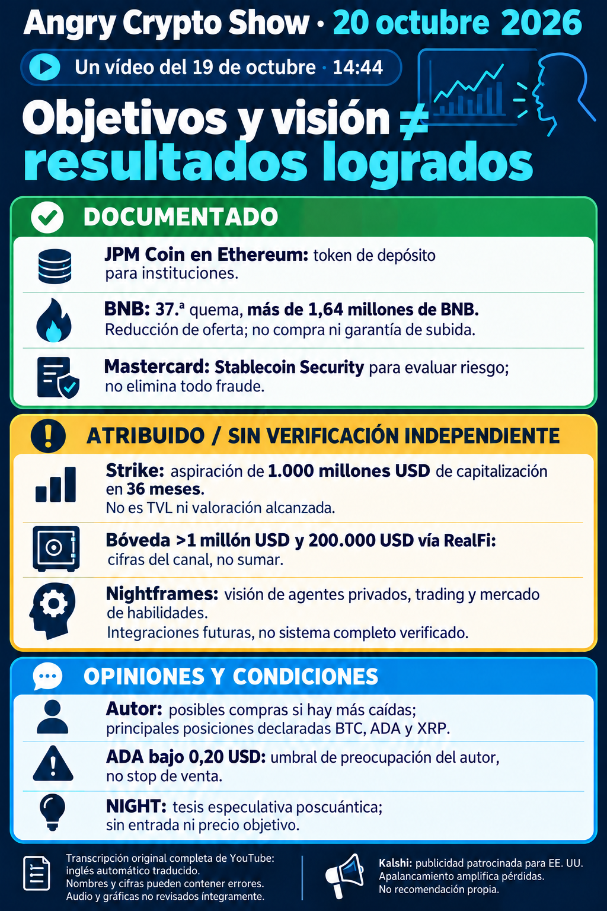

# Angry Crypto Show — síntesis del 20 de octubre de 2026

**Vídeo del 19, 23:15:24; informe del 20, corte 08:20 Europe/Madrid.** [Informe íntegro](../../raw/notes/2026-10-20-informe-angry-crypto-show.md) · [Ficha con transcripción, metadatos, fechas y fuentes](../sources/2026-10-20-informe-angry-crypto-show.md). Lectura completa del texto inglés automático; audio y gráficas sin revisión íntegra. El contraste externo corresponde al autor del informe, sin nuevas consultas primarias en esta incorporación.

## Strike: aspiración de capitalización

El canal atribuye a [Strike](../entities/strike-finance.md) **1.000 millones USD de capitalización como objetivo a 36 meses**. No es TVL alcanzado, valoración actual o precio objetivo por token; tampoco es la aspiración anterior de RealFi/TVL atribuida a Hoskinson. Anuncio original y supuestos de valoración pendientes.

La bóveda habría superado **1 millón USD de TVL** y se habrían desplegado **200.000 USD por RealFi en 72 horas**. Sin contratos o historial contrastados no se conoce el solapamiento: **no se suman**. La promesa de inversión de una cadena de hamburgueserías y una integración en estudio no demuestran capital ingresado o servicio operativo. [Procedencia y tramos](../sources/2026-10-20-informe-angry-crypto-show.md) · [RealFi](../entities/realfi.md).

## Nightframes y auditoría con IA: planes atribuidos

Los clips de TOKEN2049 describen [Nightframes](../concepts/nightframes.md), ZK/MPC/TEE, Passport, wallets, estrategias de trading y habilidades alquilables. Apertura en próximos meses y conexiones con Solana, Hyperliquid y Binance son futuras. No se verifica el sistema completo o sus garantías absolutas de privacidad, ejecución o resistencia a apagado. El concepto ya figuraba en la [fuente original de Hoskinson](../sources/2026-10-10-hoskinson-nightframes-tokio.md): repetición no es entrega nueva.

La propuesta de clústeres locales de IA para revisar código no acredita aprobación de tesorería, compra o sustitución de auditorías. Costes comparados de 100.000/500.000 USD y capacidad de modelos sin contraste. El lenguaje de intents/datos con pruebas, la valoración de Leios y las menciones a a16z/Jolt no se transforman en capacidad desplegada o resistencia poscuántica verificada. [Gobernanza](../concepts/gobernanza-y-tesoreria.md) · [Planes de Midnight](../concepts/roadmap-midnight-y-staking-night.md).

## Noticias documentadas por el autor y complemento de la wiki

- **JPM Coin/JPMD en Ethereum:** anuncio institucional del 19, no stablecoin minorista universal o integración de Cardano.
- **BNB:** quema 37 del 19, **1.646.196,44 BNB**, valor aproximado de **1.197 millones USD** entonces. La imagen resume como «más de 1,64 millones»; no es una compra o garantía de subida. El enlace RAW remite a búsqueda del blog, con límite de reproducción.
- **Mastercard Stablecoin Security:** herramienta para evaluar riesgo, sin eliminación del fraude demostrada.
- **Strategy:** el vídeo cita 267 BTC/22 millones. La [fuente primaria ya incorporada](../sources/2026-10-20-strategy-compras-bitcoin.md) precisa **267 BTC del 12–18 por 22,1 millones USD**, anunciados el 19. Es la misma compra; no una segunda noticia o precio actual. Strive, la empresa transcrita como «Bitmain», BlackRock y la red bancaria europea conservan las lagunas del informe.

[Fuentes externas y límites del contraste](../sources/2026-10-20-informe-angry-crypto-show.md). No se extiende la verificación de un caso a los demás ni se establece causa de precio.

## Actividad, opiniones y promoción

Volumen de ADA/perpetuos, transacciones y tenedores de ADA envuelto, recompensas de Solada, >525.000 transacciones de Midnight y >1.600 agentes de City son cifras atribuidas sin series reproducidas. No equivalen a entradas netas, rentabilidad o personas. [Definiciones y ventanas](../concepts/metricas-de-uso-y-adopcion.md).

VirtualBacon valora la narrativa poscuántica de NIGHT, sin entrada, objetivo o plazo; no demuestra Bitcoin roto o protección total entregada. George condiciona la recuperación de ADA al liderazgo y a una posible mejora de TVL. El presentador contempla comprar tras nuevas caídas, declara BTC/ADA/XRP como posiciones principales y se preocupa con ADA bajo **0,20 USD**, sin indicarlo como stop. No se heredan niveles de otros episodios. Kalshi es patrocinador de la promoción estadounidense de perpetuos, no una recomendación de esta wiki. [Condiciones y campos ausentes](../concepts/previsiones-atribuidas-y-publicidad.md).

## Archivo y seguimiento

Metadatos: preparación **08:22:13**, envío **08:24:22**, verificación **08:24:40** y archivo **08:24:48** del 20, Madrid. Informe, TXT y PNG coinciden en tamaños y SHA-256; originales intactos. La ingesta se registra aparte del envío y del estado histórico pendiente, sin reenviar correo.

El canal reúne **diez análisis de vídeo y un aviso de estado**. El [aviso sin vídeos nuevos del 19](2026-10-19-angry-crypto-show-sin-videos-nuevos.md) refleja el control de las 07:34, anterior a esta publicación nocturna. Se conserva sin contradicción. [Seguimiento](../topics/seguimiento-angry-crypto-show.md) · [Cardano](../entities/cardano-ada.md) · [Midnight](../entities/midnight-night.md) · [Índice de informes](index.md).
