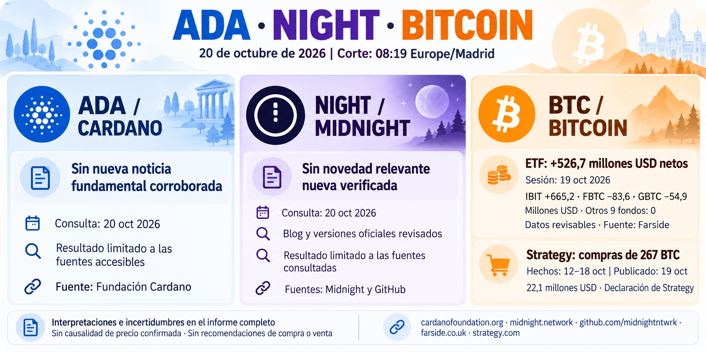

# Seguimiento de ADA, NIGHT y Bitcoin — 20 de octubre de 2026

Corte 08:19 Europe/Madrid. [Informe íntegro](../../raw/reports/2026-10-20-informe-ada-night-bitcoin.md), [metadatos](../../raw/reports/2026-10-20-informe-ada-night-bitcoin-metadatos.md), [procedencia](../sources/2026-10-20-informe-ada-night-bitcoin.md).

[Prompt y procedencia visual](../../raw/images/2026-10-20-infografia-ada-night-bitcoin-metadatos.json).

- ADA y NIGHT: sin noticia fundamental nueva corroborada en los canales accesibles, no ausencia global. No se repiten anuncios antiguos.
- [ETF](../sources/2026-10-20-farside-flujos-bitcoin.md): sesión del 19, +526,7 millones USD netos, doce datos presentes y suma comprobada; revisable.
- [Strategy](../sources/2026-10-20-strategy-compras-bitcoin.md): comunicado del 19, 267 BTC comprados del 12–18, 22,1 millones USD, saldo 848.517 BTC al 18; cifras históricas declaradas.

## Interpretación y límites

Los flujos y compras indican exposición en vehículos diferentes; no se suman como demanda simultánea ni prueban una causa de precio. Sin cotizaciones actuales, consejo de inversión, auditoría en cadena o conciliación por emisor. La fila ausente en la [consulta anterior](2026-10-19-seguimiento-ada-night-bitcoin.md) ya está publicada, conservando intacta aquella fotografía.

Bitcoin figura por solicitud expresa; ADA/NIGHT mantienen el alcance general. [Seguimiento](../topics/seguimiento-mercado-ada-night.md) · [Bitcoin](../entities/bitcoin-btc.md) · [ETF](../concepts/flujos-etf-bitcoin.md) · [Índice](index.md).

## Entrega comprobada

Enviado a gallegojc@gmail.com el 20 de octubre de 2026 a las 10:13:12 Europe/Madrid. Mensaje 1a1585f251329c04. Verificados SENT, destinatario, asunto, cuerpos completos de texto y HTML e identidad del PNG recuperado por SHA-256. [Constancia nueva](../../raw/notes/2026-10-20-envio-gmail-informe-ada-night-bitcoin.json). No acredita lectura por el destinatario.
