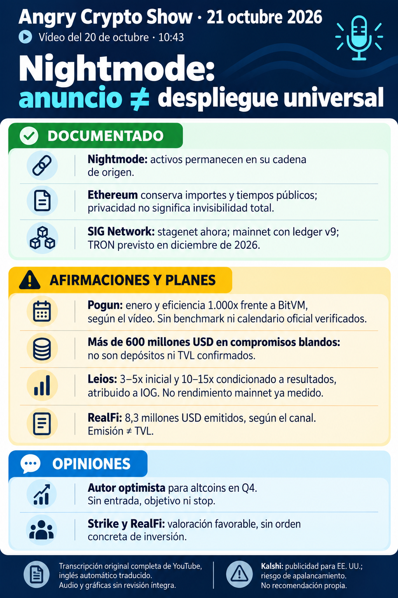

# Angry Crypto Show — síntesis del 21 de octubre de 2026

**Vídeo del 20, 22:49:01; corte del informe del 21, 08:38 Europe/Madrid.** [Original íntegro](../../raw/notes/2026-10-21-informe-angry-crypto-show.md) · [Ficha con transcripción, metadatos, tramos y fuentes](../sources/2026-10-21-informe-angry-crypto-show.md). Informe derivado; lectura completa del texto inglés automático 00:00–10:42, sin revisión íntegra del audio/gráficas ni nuevas consultas externas en esta ingesta.

## Nightmode: anuncio y estado de despliegue

La [publicación oficial de Midnight del 20](../sources/2026-10-21-midnight-nightmode.md) ya figura en la wiki y se enlaza sin otro anuncio que contar. Describe activos nativos en bóvedas MPC de origen y saldos privados representados en Midnight. En Ethereum siguen visibles **importes y tiempos del tramo público**; desvincular identidad no garantiza invisibilidad total, seguridad o custodia auditadas. La explicación del canal que sitúa los tokens en una bóveda «en Midnight» simplifica esa distinción.

El contraste del autor con [SIG Network](../entities/sig-network.md) conserva **stagenet ahora**, **mainnet con ledger v9** y **TRON previsto para diciembre de 2026**. Son estado/calendario declarados, sin operación ejecutada o disponibilidad universal comprobada. Stagenet/v9 ya aparecía en el informe del 9; no demuestra otro lanzamiento. Screening no acredita cumplimiento legal en toda aplicación o jurisdicción.

Collateral Warehouse en **Q1 de 2027** y otras capacidades de ofertas privadas entre **Q4 de 2026 y Q1 de 2027** son roadmap recogida por el autor. [Offer Files](../concepts/offer-files-y-negociacion-privada.md), dark pools, préstamos y capital institucional potencial no son todas funciones entregadas o capital captado. No se acepta la promesa absoluta de impedir cualquier front-running o negociación en contra. [Nightmode](../concepts/nightmode-privacidad-entre-redes.md) · [Planes y ejecución](../concepts/roadmap-midnight-y-staking-night.md).

## Leios y Pogun: multiplicadores por contrastar

El canal atribuye a IOG Leios **3–5x inicialmente** y **10–15x si los resultados en mainnet lo permiten**, con aumentos posteriores según demanda y economía de operación. CIP-164 y el sitio técnico documentan diseño/pruebas según el autor; el hilo y los multiplicadores no se cotejaron. No son TPS ya conseguidos, hard fork activado o capacidad garantizada para cualquier carga. [Leios](../concepts/leios-testnet-y-mainnet.md).

[Pogun](../entities/pogun.md) se anuncia para **enero sin año explícito**; 2027 es inferencia contextual pendiente, no fecha oficial. **1.000x frente a BitVM** carece de métrica, versión y benchmark reproducido; no significa mil veces más TPS de Cardano. **>600 millones USD de compromisos blandos** recordados por el presentador no son depósitos, TVL o inversión ejecutada. El entusiasmo por instrumentos con rendimiento no incluye producto o tasa recomendados. [Criterios de comparación](../concepts/benchmarks-locales-y-rendimiento-red.md).

## DeFi, métricas y recomendaciones

Strike >1.800 millones USD de volumen acumulado y >6.600 operadores, RealFi >8,3 millones USD emitidos/+700.000 semanal y las dos observaciones de volumen de Kalshi (>500.000 y unos 800.000 USD) no tienen series/definiciones reproducidas. Emisión no es TVL; operadores no son personas; observaciones distintas no se suman como entradas netas.

Swaps ADA→sUSDrf en SundaeSwap y canje nominal iUSD/USDrf 1:1 en Indigo PSM se conservan como integraciones narradas sin ruta/condiciones verificadas. «Sin deslizamiento» no implica ausencia de comisiones, liquidez ilimitada o salida garantizada. BlockFi/Blockenfy sigue ambiguo y no prueba inversión del antiguo prestamista. El hackathon anunciado para el 21, 48 horas y 3.000 USD no tiene bases o celebración verificadas; no se convierte su hora Eastern sin aclaración. [Strike](../entities/strike-finance.md) · [RealFi](../entities/realfi.md) · [Liquidez](../concepts/apr-credito-y-liquidez.md).

El presentador conserva optimismo condicional para Q4, con ADA cerca de 0,22 USD durante la grabación; sin entrada, objetivo, stop, asignación o probabilidad. El elogio de Strike/RealFi no es orden de inversión. Kalshi es patrocinador de perpetuos para estadounidenses, con condiciones actuales sin verificación completa. [Opiniones y publicidad](../concepts/previsiones-atribuidas-y-publicidad.md).

## Contexto externo y lagunas

La enmienda francesa **I-CF1826**, adoptada en comisión el **7 de octubre**, ya estaba recogida en la [edición del 15](../sources/2026-10-15-informe-angry-crypto-show.md). El **31,4 % no figura en el texto consultado por el autor**; no acredita ley vigente o tributación universal de stablecoins, ni noticia legislativa nueva del 20.

Saylor y la comparación de JPM a diez años son previsiones atribuidas. La [ficha primaria previa de JPM](../sources/2026-10-21-jpmorgan-previsiones-bitcoin.md) documenta rango y ausencia de asignación, sin validar toda la comparación del canal. Citi/Aave y el supuesto primer ETF spot suizo siguen sin documentos primarios suficientes; no se confunde ETF con ETP o con otra propuesta de producto.

## Fechas e integridad

Preparación **08:45:55**, envío registrado **08:50:00**, verificación **08:50:47** y archivo **08:52:24** del 21, Madrid. Tamaños y SHA-256 del informe, PNG y TXT comprobados; RAW intacto y estado histórico pendiente conservado. No se accede a Gmail ni se reenvía correo.

[Seguimiento: once análisis de vídeo y un aviso de estado](../topics/seguimiento-angry-crypto-show.md) · [Cardano](../entities/cardano-ada.md) · [Midnight](../entities/midnight-night.md) · [Informe anterior](2026-10-20-angry-crypto-show.md) · [Índice](index.md).
