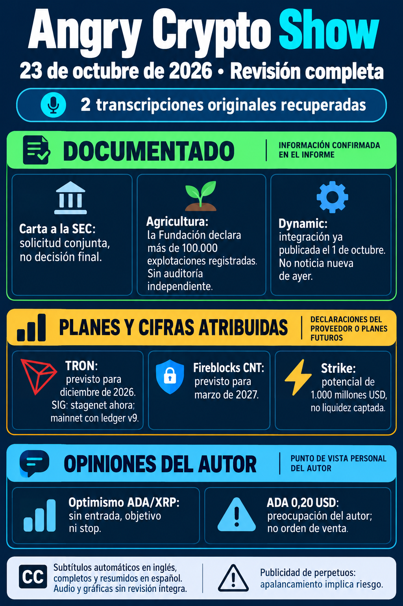

# Angry Crypto Show — 23 de octubre: revisión completa de dos vídeos

**Estado actual: A y B analizados a partir de sus transcripciones completas; limitación de acceso anterior superada.** Corte de contraste **11:49 Europe/Madrid**, 23 de octubre de 2026. [Revisión íntegra](../../raw/notes/2026-10-23-informe-angry-crypto-show-revision-completa-publicacion.md) · [Ficha actualizada, TXT, fuentes y fechas](../sources/2026-10-23-aviso-angry-acceso-limitado.md). Se conserva esta misma página y el aviso histórico, sin duplicar la ingesta de las fuentes.

## Fuentes recuperadas y alcance

- **A, SCSBS7rDNKk:** publicado el 22 a las 00:20:46 Madrid; [inglés automático completo 00:00–11:30](../../raw/transcripts/2026-10-22-angry-crypto-show-SCSBS7rDNKk.txt).
- **B, qhIpkbPM_jc:** publicado el 22 a las 23:13:57; [inglés automático completo 00:00–12:21](../../raw/transcripts/2026-10-22-angry-crypto-show-qhIpkbPM_jc.txt). Reproductor 12:22 frente a metadatos 12:23; diferencias de duración anteriores conservadas.

Informe derivado; se leyeron ambos textos, no audio/gráficas íntegros. La recuperación posterior mediante el panel autorizado de YouTube no invalida la respuesta pública vacía registrada antes. Los contrastes documentales pertenecen al autor de la revisión; esta ingesta no vuelve a consultar las fuentes externas.

## Anuncios documentados y fechas conservadas

- **Carta SEC:** las seis organizaciones solicitan reglas para digital commodities. Es documento de los firmantes alojado en SEC, **no aprobación o clasificación nueva de ADA por la carta**. Fecha exacta no consignada; no se asume el día del vídeo.
- **[Syngenta India](../entities/syngenta-foundation-india.md):** la fuente oficial ya incorporada declara **>100.000 explotaciones**, sin auditoría independiente. Los 50.000 agricultores del relato no se suman como misma unidad/población; no se cuenta otro hito nuevo.
- **[Dynamic](../entities/dynamic.md):** integración descrita oficialmente el **1 de octubre**, sin novedad de ayer demostrada. **[Fireblocks](../entities/fireblocks.md)** distingue ADA ya soportado de CNT completo **previsto para marzo de 2027**, según anuncio del 24 de septiembre. No son el mismo producto o fecha de entrega.
- **CIP-0113:** el anuncio del 7 ya está recogido; no acredita las 850.000 acciones, derechos legales/emisor u otros casos empresariales que cita el canal.

[Documentos y tramos en la ficha actualizada](../sources/2026-10-23-aviso-angry-acceso-limitado.md). Se reutilizan las fuentes anteriores y se mantienen sus límites.

## Planes, discrepancias y liquidez potencial

[SIG/Nightmode](../entities/sig-network.md) conserva **stagenet para Ethereum**, mainnet con **ledger v9**, y **TRON en diciembre de 2026** como plan. Los activos permanecen en origen; importes/tiempos públicos siguen visibles. B reconoce no haber visto confirmación de TRON/Justin Sun: no acuerdo bilateral o funcionamiento de Nightmode en TRON acreditados. Screening y metáfora VPN no garantizan privacidad absoluta o cumplimiento universal.

Roadmap: Nightstream/Passport SDK v1 **Q4 2026**, Collateral Warehouse **Q1 2027**; objetivos sin garantía de entrega, protección poscuántica total o seguridad completa ante agentes descontrolados. IA hacia 2030 y adopción masiva son escenarios, no métricas conseguidas.

Strike podría captar **1.000 millones USD de liquidez mediante Aave**, según la proyección del canal, sin capital captado, plazo o compromiso comprobados. Es distinto de la **capitalización a 36 meses** del informe del 20. No se suman unidades o se verifica un depósito solo por narrarlo.

Leios: A atribuye **hasta 60x de techo y 10–15x como primera meta**; el [informe del 21](2026-10-21-angry-crypto-show.md) recogía **3–5x inicial/10–15x posterior**. Se conservan ambas declaraciones sin hilo original o benchmark contrastados, sin sustituirlas silenciosamente o prometer rendimiento mainnet. [Criterios de Leios](../concepts/leios-testnet-y-mainnet.md).

## Métricas, opiniones y lagunas

ADA hasta 310 millones USD, Polymarket >3,2 millones y Kalshi >570.000 frente a >740.000 en A son observaciones sin series/cortes reproducidos. No se suman o prueban crecimiento continuo. Strike >260.000 USD vía sUSDrf y Solada >11 millones ADA/≈100.000 de recompensas son atribuciones, sin pagos auditados. **Transacciones de NIGHT en Cardano no son actividad privada de Midnight**, y mindshare no son usuarios.

Preferencia ADA/XRP y optimismo de Q4 sin entrada, tamaño, objetivo, stop o probabilidad. **0,20 USD es preocupación del presentador, no stop**; cerca de 0,21 USD es referencia histórica de B, no cotización actual comprobada. La tesis de cobertura poscuántica no prueba eficacia o beneficios. Kalshi sigue como publicidad, sin condiciones completas o elegibilidad del lector verificadas. [Previsiones y publicidad](../concepts/previsiones-atribuidas-y-publicidad.md).

GENIUS, Meta, Tesla, Dubái, SoFi, agentes bancarios y alusiones médicas conservan falta de contraste primario suficiente. No se incorporan como hechos o recomendaciones por aparecer en los vídeos. [Ficha: atribuciones, tramos y documentos](../sources/2026-10-23-aviso-angry-acceso-limitado.md).

## Ingesta y entrega

Cuatro archivos nuevos declarados verificados por tamaño/SHA-256; aviso original y nueva imagen intactos. Preparación/archivo registrados **11:49:55**. Se completó la ingesta de esta revisión: **trece vídeos analizados**, dos avisos históricos conservados y estos dos vídeos ya sin estado pendiente. El correo de la mañana contenía el aviso; **no se afirma enviada esta revisión completa**. Sin correo, commit o push en esta operación.

[Seguimiento actualizado](../topics/seguimiento-angry-crypto-show.md) · [Índice](index.md).

## Historial: aviso inicial de las 10:18 (acceso limitado resuelto)

Se conserva a continuación el registro anterior. Su falta de texto y sus dos pendientes corresponden al corte de aquella revisión, superado por las transcripciones recuperadas.

**Aviso de estado al corte del 23 de octubre de 2026, 10:18 Europe/Madrid. Los dos vídeos siguen pendientes de análisis.** [Aviso íntegro](../../raw/notes/2026-10-23-informe-angry-crypto-show.md) · [Procedencia, fechas y metadatos](../sources/2026-10-23-aviso-angry-acceso-limitado.md).

## Qué está identificado

Según la consulta pública documentada por el autor, ambos pertenecen a Angry Crypto Show:

| Vídeo | Publicación Madrid | Duración de metadatos | Estado |
|---|---|---|---|
| [qhIpkbPM_jc](https://www.youtube.com/watch?v=qhIpkbPM_jc) | 22 de octubre, **23:13:57** | **12:23** | Nuevo desde la revisión anterior; sin análisis del contenido. |
| [SCSBS7rDNKk](https://www.youtube.com/watch?v=SCSBS7rDNKk) | 22 de octubre, **00:20:46** | **11:31** | Pendiente desde la ejecución interrumpida del 22; tarjeta del canal mostraba 11:32. |

El segundo corresponde al **21 a las 22:20:46 UTC** y al **22 en Madrid**; no son dos publicaciones. Los títulos identificativos permanecen en RAW, sin convertirlos en noticias, métricas o recomendaciones verificadas. Esta ingesta no vuelve a comprobar YouTube.

## Qué falta

Las dos pistas inglesas automáticas anunciadas devolvieron **HTTP 200 con cero bytes**, según el registro de origen. No se recuperó texto legible y **no existe archivo de transcripción**; eso no demuestra que no haya subtítulos en la interfaz. Audio y gráficas no se revisaron íntegramente. Sin contenido suficiente, no se atribuyen compras, ventas, niveles, horizontes o declaraciones desde títulos y no se inventan marcas de tiempo.

El rechazo automático del conector de Brave descrito para el 22 se conserva como antecedente, sin repetirlo, eludirlo o cambiar permisos en esta ingesta. La vía pública posterior tampoco aportó texto. El análisis del [último episodio completo, edición del 21](2026-10-21-angry-crypto-show.md), no se reutiliza para aparentar análisis de los dos pendientes.

## Archivo del aviso y continuidad

La ejecución del 22 quedó interrumpida y no se halló correo de esa fecha en la búsqueda descrita por el autor; no se afirma que estuviera entregado. Se preparó **un solo aviso fechado el 23**, a las **10:21:51**. Los metadatos registran envío a las **10:25:52**, verificación a las **10:26:36** y archivo a las **10:26:50**, Madrid. El estado de búsqueda previo y esa entrega posterior se conservan separados.

Aviso e infografía mantienen tamaño y SHA-256 verificados; RAW permanece intacto. Está completada la incorporación **del aviso**, mientras el contenido de ambos vídeos sigue sin ingerir ni analizar. No se consulta Gmail o reenvía correo.

El seguimiento queda en **once análisis de vídeo, dos avisos de estado y dos vídeos pendientes**. El [aviso del 19 sin vídeos nuevos](2026-10-19-angry-crypto-show-sin-videos-nuevos.md) y este aviso tienen causas distintas. [Seguimiento del canal](../topics/seguimiento-angry-crypto-show.md) · [Índice de informes](index.md).
