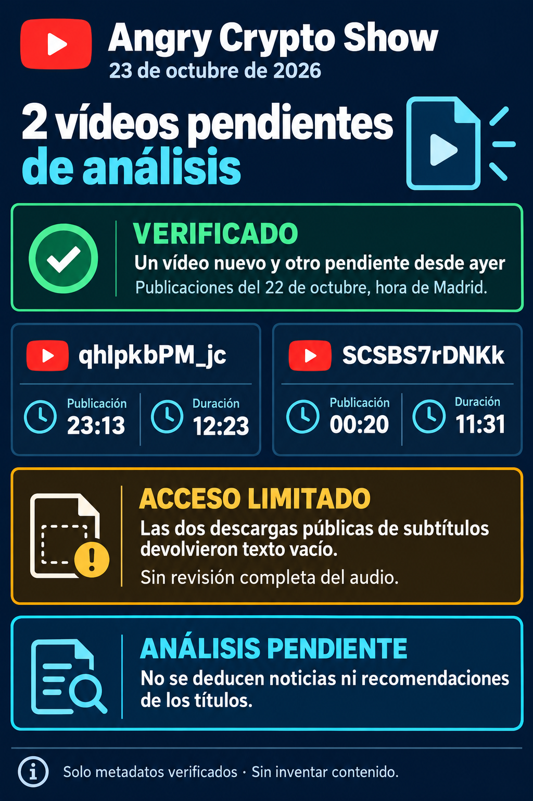

# Angry Crypto Show — 23 de octubre: acceso limitado

**Aviso de estado al corte del 23 de octubre de 2026, 10:18 Europe/Madrid. Los dos vídeos siguen pendientes de análisis.** [Aviso íntegro](../../raw/notes/2026-10-23-informe-angry-crypto-show.md) · [Procedencia, fechas y metadatos](../sources/2026-10-23-aviso-angry-acceso-limitado.md).

## Qué está identificado

Según la consulta pública documentada por el autor, ambos pertenecen a Angry Crypto Show:

| Vídeo | Publicación Madrid | Duración de metadatos | Estado |
|---|---|---|---|
| [qhIpkbPM_jc](https://www.youtube.com/watch?v=qhIpkbPM_jc) | 22 de octubre, **23:13:57** | **12:23** | Nuevo desde la revisión anterior; sin análisis del contenido. |
| [SCSBS7rDNKk](https://www.youtube.com/watch?v=SCSBS7rDNKk) | 22 de octubre, **00:20:46** | **11:31** | Pendiente desde la ejecución interrumpida del 22; tarjeta del canal mostraba 11:32. |

El segundo corresponde al **21 a las 22:20:46 UTC** y al **22 en Madrid**; no son dos publicaciones. Los títulos identificativos permanecen en RAW, sin convertirlos en noticias, métricas o recomendaciones verificadas. Esta ingesta no vuelve a comprobar YouTube.

## Qué falta

Las dos pistas inglesas automáticas anunciadas devolvieron **HTTP 200 con cero bytes**, según el registro de origen. No se recuperó texto legible y **no existe archivo de transcripción**; eso no demuestra que no haya subtítulos en la interfaz. Audio y gráficas no se revisaron íntegramente. Sin contenido suficiente, no se atribuyen compras, ventas, niveles, horizontes o declaraciones desde títulos y no se inventan marcas de tiempo.

El rechazo automático del conector de Brave descrito para el 22 se conserva como antecedente, sin repetirlo, eludirlo o cambiar permisos en esta ingesta. La vía pública posterior tampoco aportó texto. El análisis del [último episodio completo, edición del 21](2026-10-21-angry-crypto-show.md), no se reutiliza para aparentar análisis de los dos pendientes.

## Archivo del aviso y continuidad

La ejecución del 22 quedó interrumpida y no se halló correo de esa fecha en la búsqueda descrita por el autor; no se afirma que estuviera entregado. Se preparó **un solo aviso fechado el 23**, a las **10:21:51**. Los metadatos registran envío a las **10:25:52**, verificación a las **10:26:36** y archivo a las **10:26:50**, Madrid. El estado de búsqueda previo y esa entrega posterior se conservan separados.

Aviso e infografía mantienen tamaño y SHA-256 verificados; RAW permanece intacto. Está completada la incorporación **del aviso**, mientras el contenido de ambos vídeos sigue sin ingerir ni analizar. No se consulta Gmail o reenvía correo.

El seguimiento queda en **once análisis de vídeo, dos avisos de estado y dos vídeos pendientes**. El [aviso del 19 sin vídeos nuevos](2026-10-19-angry-crypto-show-sin-videos-nuevos.md) y este aviso tienen causas distintas. [Seguimiento del canal](../topics/seguimiento-angry-crypto-show.md) · [Índice de informes](index.md).
