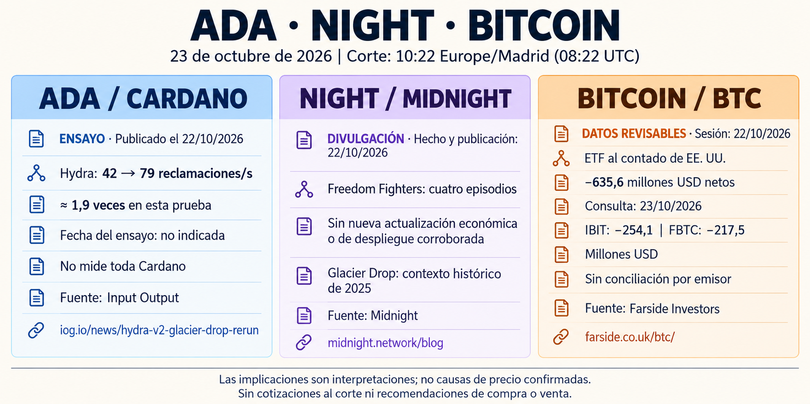

# Seguimiento de ADA, NIGHT y Bitcoin — 23 de octubre de 2026

Corte 10:22 Europe/Madrid. [Informe completo](../../raw/reports/2026-10-23-informe-ada-night-bitcoin.md), [metadatos](../../raw/reports/2026-10-23-informe-ada-night-bitcoin-metadatos.md) y [procedencia](../sources/2026-10-23-informe-ada-night-bitcoin.md). Alcance general ADA/NIGHT; Bitcoin por petición expresa.

[Prompt y procedencia visual](../../raw/images/2026-10-23-infografia-ada-night-bitcoin-metadatos.json).

- [Hydra](../sources/2026-10-23-hydra-reensayo-glacier-drop.md): publicación del 22, 42 a 79 reclamaciones/s en un ensayo del equipo; fecha exacta de ejecución ausente. No rendimiento de toda Cardano.
- [NIGHT](../sources/2026-10-23-midnight-freedom-fighters.md): cuatro episodios divulgativos publicados el 22; no actualización económica o despliegue. El Glacier Drop del ensayo es de 2025, sin nuevo reparto.
- [ETF de BTC](../sources/2026-10-23-farside-flujos-bitcoin.md): sesión del 22, −635,6 millones USD revisables, doce cifras y suma comprobadas. Tabla consultada el 23, sin publicación exacta o conciliación por emisor.
- DijkstraNet y Genius Yield: pistas secundarias sin contraste primario suficiente; no se elevan a hechos confirmados. Sin cotizaciones al corte o causa única del precio.

La lectura directa se limita a las fuentes originales indicadas; la síntesis sigue siendo derivada, sin reproducción de ensayos o conciliación de fondos. [Edición previa](2026-10-22-seguimiento-ada-night-bitcoin.md) conservada con su corte; el nuevo anuncio de divulgación y la nueva sesión no la contradicen. [Seguimiento](../topics/seguimiento-mercado-ada-night.md) · [Benchmarks](../concepts/benchmarks-locales-y-rendimiento-red.md) · [Índice](index.md).
