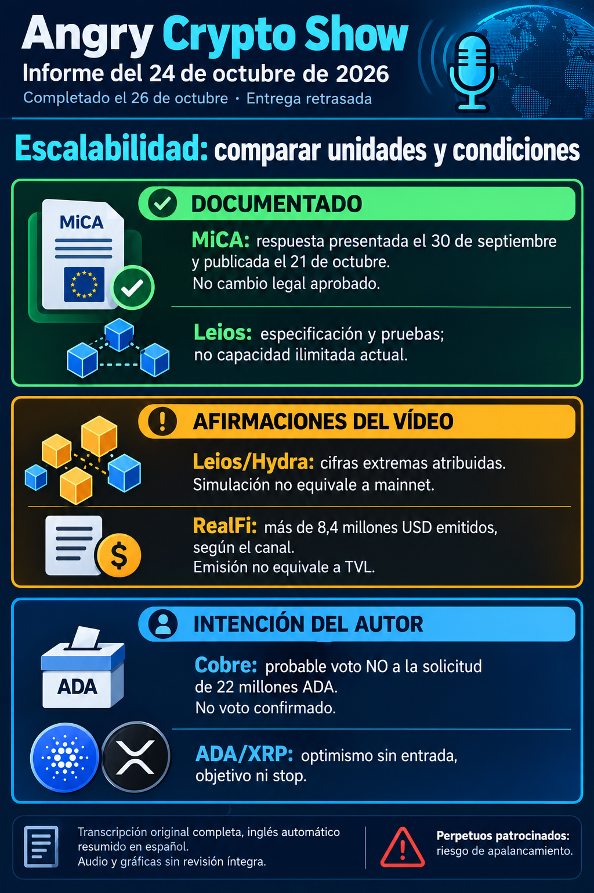

# Angry Crypto Show — edición del 24 de octubre, entrega retrasada del 26

**Vídeo publicado el 23; edición iniciada el 24; contraste, preparación, entrega e ingesta el 26.** Corte efectivo: **26 de octubre de 2026, 07:52 Europe/Madrid (CET, UTC+1)**. [Informe íntegro](../../raw/notes/2026-10-24-informe-angry-crypto-show.md) · [Ficha, TXT original, metadatos y fechas](../sources/2026-10-24-informe-angry-crypto-show.md). No se retrodata la ejecución ni se presenta como revisión del canal de los días 25/26.

## Escalabilidad: comparar unidades y condiciones

El canal atribuye a Hoskinson cifras extremas de TPS de Leios y simulaciones de Hydra, nuevo lenguaje, escalabilidad infinita y resolución del trilema. **No son rendimiento mainnet demostrado.** No se reprodujeron el ensayo del millón o la entrevista íntegra.

Según el contraste del autor, **CIP-0164** usa escenarios de **140.000–300.000 bytes de transacciones/s**, aproximadamente **100–200 TPS de transacciones medias** bajo sus condiciones. No son cientos de miles de TPS ni una conversión universal: tamaño/complejidad, versión y entorno importan. Hydra por aplicación y cadena base no se suman. Se preservan las declaraciones distintas de los episodios previos, sin resolver por conjetura sus diferencias. [Leios](../concepts/leios-testnet-y-mainnet.md) · [Benchmarks](../concepts/benchmarks-locales-y-rendimiento-red.md).

## Documentación y entregas pendientes de prueba

El autor consulta artículos de IO sobre Blaster/Lean 4 y High Assurance. Documentan herramientas, propiedades, contraejemplos y fases de desarrollo; no prueban el parche reciente o primera versión de Hades sin release/commit concreto. Una prueba formal depende de su especificación y supuestos, no elimina todos los riesgos. [Verificación formal](../concepts/verificacion-formal-y-supuestos.md).

La respuesta **MiCA** ya incorporada se presentó el **30 de septiembre** y publicó el **21 de octubre**. Defiende proporcionalidad y distinguir staking directo de servicios con custodia. Es posición en consulta, **no reforma o exención aprobadas**, y no otra noticia nueva por repetición. [Fuente anterior](../sources/2026-10-22-cardano-respuesta-mica.md).

SIG, consultado por el autor el **26**, mantiene stagenet, mainnet con ledger v9 y TRON previsto en diciembre de 2026. No se convierte en servicio operativo el 24 ni cumplimiento universal. Los activos potenciales de Midnight, transferencias trimestrales de TRON y relación con Filecoin no fueron contrastados como importes o acuerdos realizados. [Nightmode](../concepts/nightmode-privacidad-entre-redes.md).

## Cobre: intención provisional, no voto confirmado

El presentador anticipa aproximadamente **99 % de inclinación a votar NO** a los **22 millones ADA**, con justificación por preparar y petición de opiniones. **No confirma voto emitido, resultado comunitario, rechazo o desembolso.** El sentimiento relatado no es encuesta y los días relativos de la grabación no fijan el vencimiento actual.

El foro identifica Toto Finance y el debate; se relaciona con la [propuesta ya documentada](../sources/2026-10-16-cardano-propuesta-cobre.md), sin otra aprobación que inferir. [Gobernanza: propuesta, intención y ejecución](../concepts/gobernanza-y-tesoreria.md).

## Métricas, opinión y promoción

RealFi >**8,4 millones USD emitidos**, +100.000/72 h, y >**6.900 holders** de ADA envuelta son cifras atribuidas sin series/contrato reproducidos. Emisión no es TVL; holders no son personas. Los >1,1 millones USD de perpetuos transcritos como KuCoin no verifican plataforma o ventana y no se mezclan con Kalshi/Polymarket.

El optimismo ADA/XRP no fija compra/venta, objetivo, stop, tamaño o recuperación. ADA >0,21 USD es referencia de grabación, no precio actual. La frase de CZ y la oposición empresarial a tokenización de acciones quedan sin fuentes primarias suficientes; Kalshi sigue como patrocinador, sin oferta validada al lector. [Condiciones y lagunas](../sources/2026-10-24-informe-angry-crypto-show.md) · [Previsiones y publicidad](../concepts/previsiones-atribuidas-y-publicidad.md).

## Trazabilidad y alcance temporal

TXT inglés completo **00:00–10:35**, sin revisión íntegra de audio/gráficos. Duración reproductor **10:37** frente a metadatos **10:38**, diferencia conservada. Los contrastes documentales son los del autor; esta ingesta no reabre las fuentes externas.

Preparación **26 a las 07:55:37** y archivo **08:03:58**, Madrid. Las constancias privadas de entrega permanecen en local. Informe, TXT e imagen coinciden en tamaños y SHA-256. RAW conserva su estado histórico pendiente; incorporación posterior registrada aparte, sin correo, commit o push.

El seguimiento suma **catorce vídeos analizados**, con dos avisos históricos. La [revisión completa del 23](2026-10-23-angry-crypto-show-acceso-limitado.md) permanece separada; esta entrega no la reenvía y **no acredita revisión del canal del 25 o 26**. [Seguimiento](../topics/seguimiento-angry-crypto-show.md) · [Índice](index.md).
