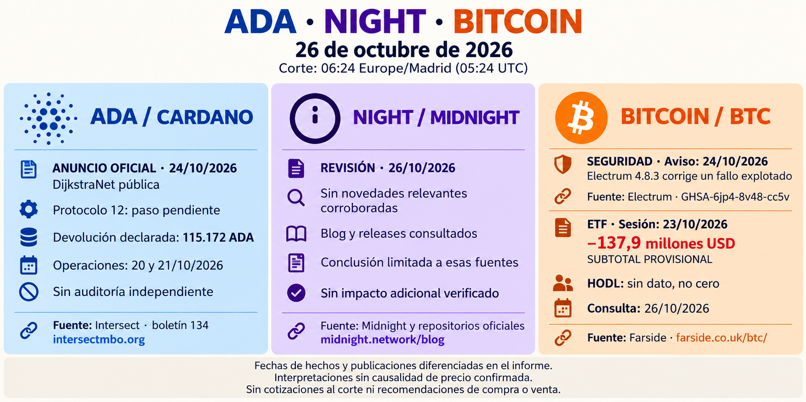

# Seguimiento de ADA, NIGHT y Bitcoin — 26 de octubre de 2026

Corte 06:24 Europe/Madrid (05:24 UTC). Ejecución iniciada el 24, completada el 26; no informe terminado o enviado retrospectivamente los días 24/25. [Cuerpo completo](../../raw/reports/2026-10-26-informe-ada-night-bitcoin.md), [metadatos](../../raw/reports/2026-10-26-informe-ada-night-bitcoin-metadatos-publicacion.json) y [procedencia](../sources/2026-10-26-informe-ada-night-bitcoin.md).

[Prompt y herramienta](../../raw/reports/2026-10-26-informe-ada-night-bitcoin-metadatos-publicacion.json).

- [Intersect](../sources/2026-10-26-intersect-dijkstranet-tesoreria.md), publicado el 24: testnet disponible con transición al protocolo 12 pendiente; devolución declarada 115.172 ADA del 20–21, sin auditoría independiente. Discordancia martes/21 en el original conservada.
- [Desarrollo](../sources/2026-10-26-cardano-desarrollo.md), publicado el 23: componentes Leios en main del código, no mainnet.
- NIGHT: sin noticia relevante nueva corroborada en blog y listados de node/midnight-js revisados; conclusión limitada, no ausencia global.
- [Electrum](../sources/2026-10-26-electrum-seguridad.md): aviso y binarios del 24, etiqueta del 23; parche 4.8.3 frente a ataque activo declarado. Cuantía no publicada.
- [ETF](../sources/2026-10-26-farside-flujos-bitcoin.md), sesión del 23: subtotal −137,9 millones USD; HODL sin dato, revisable y sin conciliación por emisores.

Se completa con fuente primaria la laguna DijkstraNet de la [edición del 23](2026-10-23-seguimiento-ada-night-bitcoin.md), conservando su evaluación histórica. No cotizaciones al corte o causa única de precio. Fuentes primarias consultadas directamente por el autor; informe y esta síntesis derivados. ADA/NIGHT mantiene alcance general; BTC por petición expresa. [Seguimiento](../topics/seguimiento-mercado-ada-night.md) · [Índice](index.md).
