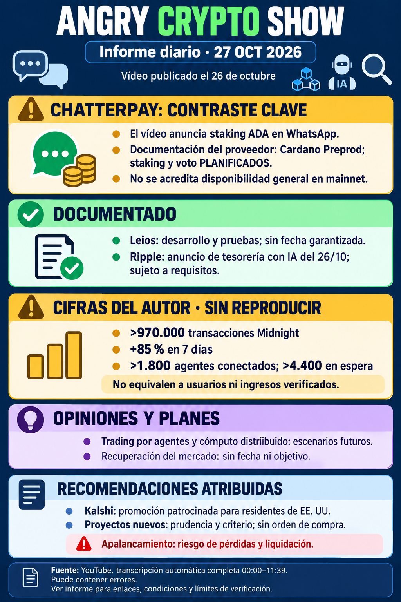

# Angry Crypto Show — 27 de octubre de 2026

**Corte: 27 de octubre, 09:09:17 Europe/Madrid (CET).** Vídeo publicado el 26 a las 22:48:41; TXT inglés automático completo 00:00–11:39. [Informe íntegro](../../raw/notes/2026-10-27-informe-angry-crypto-show.md) · [Procedencia, fuentes y límites](../sources/2026-10-27-informe-angry-crypto-show.md).

El contraste principal es **ChatterPay**: el vídeo anuncia staking y gobernanza ADA por WhatsApp disponibles, mientras la documentación del proveedor consultada por el autor mantiene **Cardano Preprod y staking/voto planificados**. No se acredita disponibilidad general mainnet o respaldo de Meta. La contradicción queda abierta hasta identificar versión, entorno y prueba de funcionamiento. [ChatterPay](../entities/chatterpay.md).

**Leios:** desarrollo y pruebas; el 5 % atribuido carece de denominador reproducido y no mide activación en la red o fecha de entrega. **Peras:** identificación interpretada de «Paros», CIP-140 propuesta para asentamiento y condiciones de cuórum, sin segundos universales o mayor capacidad por bloque. [Leios](../concepts/leios-testnet-y-mainnet.md) · [Peras](../entities/peras.md).

**Midnight:** >970.000 transacciones, +85 %/7 días y agentes >1.800 conectados/>4.400 en cola son cifras del canal sin consulta/corte/método reproducidos; no personas o ingresos. Trading por agentes, inteligencia tokenizada y cómputo distribuido son escenarios futuros. Passport v1 Q4 y composición/interoperabilidad siguen como roadmap, sin entrega o seguridad poscuántica total probadas. [Métricas](../concepts/metricas-de-uso-y-adopcion.md) · [Midnight City](../entities/midnight-city.md).

**Otras atribuciones:** cbADA, Solada, volumen ADA y fondos tokenizados conservan sus unidades/cortes sin reconstruir series o pagos. Solicitud de listado no es aprobación. El anuncio Ripple del 26 se atribuye al emisor y sus requisitos; compras de Vanguard y de la empresa de Tom Lee siguen sin contraste primario. [Solada](../entities/solada.md).

**Opinión y promoción:** recuperación sin fecha/objetivo, prudencia y apertura a proyectos sin orden de compra. Kalshi es invitación patrocinada para estadounidenses, sin términos o niveles completos comprobados; SUI 20x es oferta citada, no instrucción de abrir posición. Riesgos editoriales no se atribuyen al presentador ni se añaden recomendaciones propias. [Previsiones y publicidad](../concepts/previsiones-atribuidas-y-publicidad.md).

Preparación 09:11:53, archivo 09:14:18, Madrid. Constancias atribuidas al origen; sin nuevo correo. Los tres archivos coinciden en huellas y tamaños; audio/gráficas sin revisión íntegra. Los contrastes documentales son del autor, sin nuevas consultas externas en esta ingesta. Quince vídeos analizados y tres avisos de estado; este nuevo vídeo posterior no invalida el aviso del 26 a las 08:07:43. La serie diaria ADA/NIGHT/BTC sigue separada. [Seguimiento](../topics/seguimiento-angry-crypto-show.md) · [Índice](index.md).
