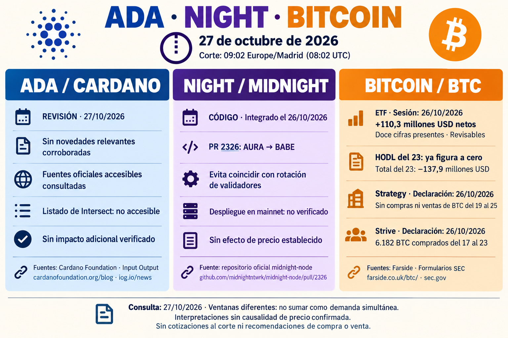

# Seguimiento de ADA, NIGHT y Bitcoin — 27 de octubre de 2026

Corte 09:02 Europe/Madrid. [Cuerpo completo](../../raw/reports/2026-10-27-informe-ada-night-bitcoin.md), [metadatos](../../raw/reports/2026-10-27-informe-ada-night-bitcoin-metadatos-publicacion.json) y [procedencia](../sources/2026-10-27-informe-ada-night-bitcoin.md). ADA/NIGHT como alcance general; BTC por petición expresa.

[Prompt y herramienta](../../raw/reports/2026-10-27-informe-ada-night-bitcoin-metadatos-publicacion.json).

- ADA: sin nueva noticia relevante corroborada en fuentes accesibles; Intersect listado falló por tamaño. No repetición de Leios.
- [Midnight](../sources/2026-10-27-midnight-transicion-consenso.md): PR 2326 integrada el 26, aplaza AURA→BABE si coincide rotación; no despliegue o migración mainnet comprobados.
- [ETF](../sources/2026-10-27-farside-flujos-bitcoin.md): sesión del 26 +110,3 millones USD revisables, doce cifras; HODL del 23 ahora cero cierra ausencia sin cambiar −137,9.
- [Strategy](../sources/2026-10-27-strategy-sin-compras-bitcoin.md): declaración del 26, sin compras/ventas BTC del 19–25; 204,9 millones USD a STRC.
- [Strive](../sources/2026-10-27-strive-compras-bitcoin.md): declaración del 26, 6.182 BTC del 17–23 y saldo 43.000 al 23.

Fuentes primarias leídas directamente por el autor; informe/síntesis derivados. Sin ejecución propia de pruebas, auditoría de custodia o conciliación por emisor. Ventanas distintas, sin sumarlas como demanda simultánea. No causa única o cotización al corte. Se conserva la [edición del 26](2026-10-26-seguimiento-ada-night-bitcoin.md), su guion HODL y su búsqueda limitada; esta incorporación añade otra fila y una PR posterior.

[Seguimiento](../topics/seguimiento-mercado-ada-night.md) · [Migración y comités](../concepts/migracion-consenso-y-rotacion-comites.md) · [Índice](index.md).
