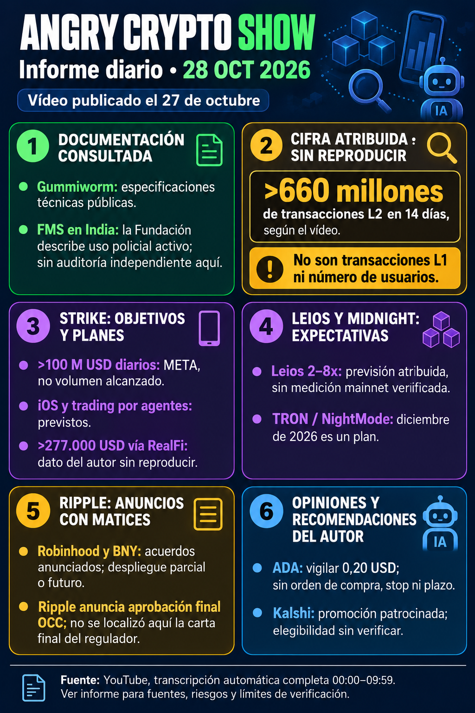

# Angry Crypto Show — 28 de octubre de 2026

**Corte: 28 de octubre, 09:00:51 Europe/Madrid (CET).** Vídeo publicado el 27 a las 21:53:45; TXT automático inglés completo 00:00–09:59, audio/gráficas sin revisión íntegra. [Informe original](../../raw/notes/2026-10-28-informe-angry-crypto-show.md) · [Procedencia y contrastes](../sources/2026-10-28-informe-angry-crypto-show.md).

**Gummiworm/Sugar Rush:** especificaciones públicas descritas por el autor. **>660 millones de operaciones L2 en 14 días** es cifra del canal sin dataset reproducido; no L1 o usuarios. La demo de abril de un único peer, ~4.000 TPS de pico/~3.400 sostenidos, es otro experimento informal: no confirma ni refuta la competición ni mide todo el sistema. Intel TDX y especificaciones no prueban privacidad absoluta o auditoría completa. [Gummiworm](../entities/gummiworm.md) · [Benchmarks](../concepts/benchmarks-locales-y-rendimiento-red.md).

**Strike/RealFi:** >100 millones USD/día es meta comercial; iOS, agentes y activos con rendimiento son planes, sin aprobación App Store o retorno garantizados. >277.000 USD vía RealFi es dato atribuido sin corte/desglose reproducidos; acercarse al millón es aspiración. No se intercambian volumen diario, capital desplegado, TVL y capitalización. [Strike](../entities/strike-finance.md) · [RealFi](../entities/realfi.md).

**FMS en India:** la Fundación documenta uso en casos activos de Uttar Pradesh, con identificadores e integridad de escaneos/resultados anclada mediante hashes. No auditoría de cobertura o fecha nueva de inicio demostradas. Integridad posterior no acredita verdad de la prueba original ni publica íntegra toda evidencia. [FMS](../entities/trivolvetech-fms.md) · [Hashes y procedencia](../concepts/hashes-integridad-y-procedencia.md).

**Leios/Midnight:** 2–8x inicial es previsión sin carga base o medición mainnet comparables. Fases y gobernanza siguen pendientes; infinito/trilema no se convierten en resultado. TRON/NightMode para diciembre continúa como plan con límites del tramo público. Referencias a NIST u organizaciones no acreditan respaldo institucional o seguridad poscuántica desplegada. [Leios](../concepts/leios-testnet-y-mainnet.md) · [NightMode](../concepts/nightmode-privacidad-entre-redes.md).

**Ripple:** anunció aprobación final OCC el 26; el autor no localizó carta final del regulador. La carta OCC de diciembre de 2025 es condicional, no prueba por sí sola del cumplimiento posterior. Robinhood/BNY son anuncios del 27 con componentes parciales, futuros o sujetos a aprobaciones; no todo operativo. Se conserva la distinción entre anuncio empresarial y documento regulatorio. [Fuentes y alcance](../sources/2026-10-28-informe-angry-crypto-show.md) · [Regulación](../concepts/regulacion-por-actividad-y-participacion-protocolo.md).

ADA 0,20 USD es vigilancia atribuida, sin operación o stop. Kalshi es promoción patrocinada; acceso canadiense no confirmado. Mejores productos/acuerdos/UX es propuesta estratégica, sin orden de compra o revalorización garantizada. Cotizaciones ambiguas omitidas; sin recomendación propia. [Opiniones y publicidad](../concepts/previsiones-atribuidas-y-publicidad.md).

Preparación09:02:15, archivo09:03:08, Madrid; constancias atribuidas al origen sin reenviar. Tres tamaños/SHA-256 comprobados y RAW intacto. Lecturas primarias del autor, sin nuevas consultas externas en esta ingesta. **Dieciséis vídeos analizados y tres avisos conservados**, sin duplicar la [edición del 27](2026-10-27-angry-crypto-show.md) o la serie diaria independiente. [Seguimiento](../topics/seguimiento-angry-crypto-show.md) · [Índice](index.md). Solo local, sin commit o push.
